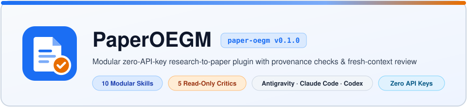
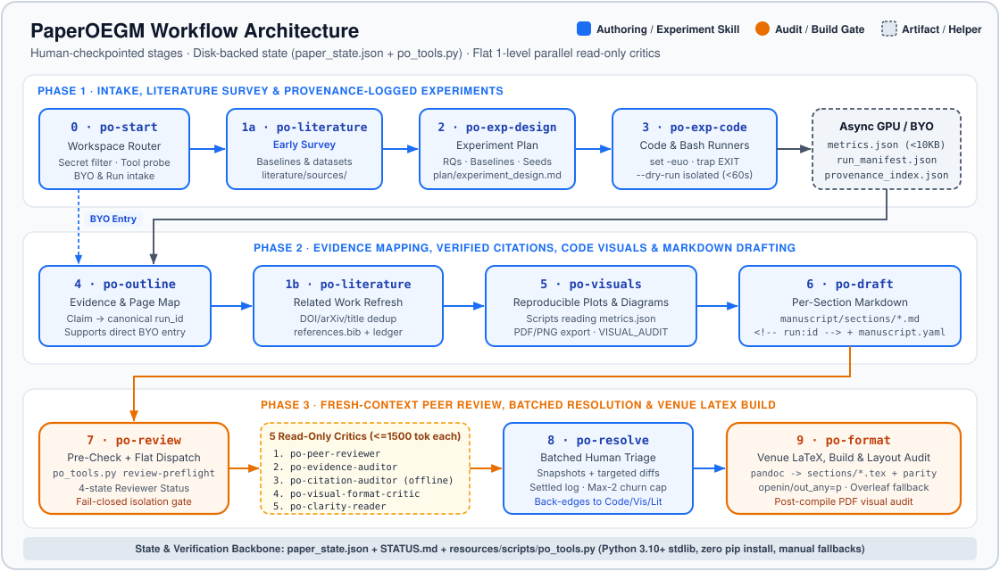

<p align="center">
  
</p>

**PaperOEGM** (`paper-oegm` — **O**rchestra-**EGM**, combining PaperOrchestra's staged paper-writing workflow with the Elephant-Goldfish Model's multi-harness plugin and fresh-context review design) is a modular, zero-API-key research-to-paper plugin for AI coding agents across **Antigravity**, **Claude Code / Cowork**, and **Codex / ChatGPT Work**. Authored by **Chen-XueWen**, it guides researchers from raw ideas, starter codebases, or existing experiment logs to provenance-checked, venue-formatted LaTeX manuscripts through 10 interactive skills, a zero-dependency Python 3.10+ stdlib verification helper, and 5 fresh-context read-only peer-review critics.

## Why PaperOEGM

* **Zero external API keys & zero runtime `pip install`:** Every skill executes strictly through the active coding harness's built-in tools and optional local CLI binaries (`python3`, `pandoc`, `pdflatex`/`latexmk`, `bibtex`, `pdftoppm`, `pdfinfo`), with documented fallbacks when any binary is absent.
* **End-to-end or mid-pipeline Bring-Your-Own (BYO) entry:** Start from a raw research idea (including experiment design and safe runnable GPU bash scripts), or jump straight into outlining and drafting with your own CSV/JSON results, existing figures, and Zotero `.bib` library.
* **Scientific integrity by construction:** Isolates `--dry-run` synthetic tests (`is_synthetic: true`), requires checked-in plotting scripts reading canonical `metrics.json` for newly generated quantitative figures, stores raw primary-source snapshots under `literature/sources/`, and runs deterministic pre-checks (`resources/scripts/po_tools.py`) before peer review and LaTeX compilation.
* **Fresh-context parallel peer review:** Dispatches 5 stateless read-only critic personas flat in parallel directly from the root session—avoiding nested orchestrator failures across Antigravity, Claude Cowork, and Codex.

## Workflow Overview

<p align="center">
  
</p>

## Sample Output

To see a complete end-to-end paper generated with **PaperOEGM** (from Stage 0 `po-start` through Stage 9 `po-format`, including verified primary-source literature snapshots, reproducible plots, flat parallel peer-review reports, and double-blind ACM SIGPLAN LaTeX compilation), view the sample compiled PDF at [`paper_workspace/submission/main.pdf`](https://github.com/Chen-XueWen/paper-oegm/blob/main/paper_workspace/submission/main.pdf) (along with the full workspace artifacts under [`paper_workspace/`](https://github.com/Chen-XueWen/paper-oegm/tree/main/paper_workspace)).

## Modular Skills (`po-*`)

| Stage | Skill | Purpose | Primary Output |
| --- | --- | --- | --- |
| 0 | `po-start` | Workspace router, adaptive intake (secret denylist), tool probe, template-year check, BYO & run registration | `paper_state.json`, `STATUS.md`, `intake_manifest.md` |
| 1 | `po-literature` | Dual-phase literature review (`1a` early baseline survey before experiments; `1b` late Related Work refresh after `po-outline`) with primary-source snapshots & deduplication | `literature/{references.bib, citation_ledger.json, sources/, literature_review.md}` |
| 2 | `po-exp-design` | Research questions, falsifiable hypotheses, fair baselines, ablations, seeds, and metric schemas | `plan/experiment_design.md` |
| 3 | `po-exp-code` | Parameterized experiment code, `env.sh`, `check_env.sh`, and safe `set -euo pipefail` / `trap EXIT` bash runners | `experiments/run_*.sh`, `dry_run/` smoke checks |
| 4 | `po-outline` | Reconciles planned vs. actual canonical runs (including negative results) and maps claims to sections & figures | `plan/outline.md` |
| 5 | `po-visuals` | Reproducible Python plots reading canonical `metrics.json` + vector conceptual diagrams with `VISUAL_AUDIT` status | `visuals/{scripts/, assets/, manifest.md}` |
| 6 | `po-draft` | Single-source per-section LaTeX-friendly Markdown with inline `<!-- run:<run_id> -->` provenance comments | `manuscript/{manuscript.yaml, sections/*.md}` |
| 7 | `po-review` | Runs `po_tools.py review-preflight` and dispatches up to 5 read-only critics flat in parallel (fail-closed isolation) | `reviews/round_<N>/review_report.md` |
| 8 | `po-resolve` | Snapshots sections, triages findings in 3 batches (mechanical, scientific, polish), applies approved edits & back-edges | `reviews/round_<N>/resolution_report.md` |
| 9 | `po-format` | `pandoc` Markdown-to-LaTeX conversion + parity checks, paranoid local TeX build (or Overleaf bundle), layout audit | `submission/{main.tex, sections/*.tex, main.pdf, build_report.md}` |

## Fresh-Context Read-Only Critics (`agents/`)

| Critic Persona | Role & Audit Scope |
| --- | --- |
| `po-peer-reviewer` | Originality, technical soundness, experimental adequacy, baselines, ablations, and explicit limitations |
| `po-evidence-auditor` | Verifies reported numbers and plot scripts against canonical `metrics.json`, `run_manifest.json`, and BYO sources; blocks `is_synthetic: true` |
| `po-citation-auditor` | Offline 1:1 audit across manuscript citation keys, `references.bib`, `citation_ledger.json`, and `literature/sources/` (zero URL fetches) |
| `po-visual-format-critic` | Audits figure legibility/data fidelity during `po-review` and compiled PDF layout, margins, page limits, and double-blind compliance during `po-format` |
| `po-clarity-reader` | Fresh naive academic reader auditing undefined notation, unexplained acronyms, logical jumps, and structural flow |

## Installation

### Antigravity

Build the standalone Antigravity runtime bundle and install it into `~/.gemini/config/plugins/paper-oegm/`:

```bash
python3 scripts/pack_plugin.py --target antigravity --output /tmp/paper-oegm-dist
rm -rf ~/.gemini/config/plugins/paper-oegm
cp -R /tmp/paper-oegm-dist/paper-oegm-antigravity ~/.gemini/config/plugins/paper-oegm
```

### Claude Code & Cowork

Install from the GitHub marketplace or build a local runtime archive (see [docs/claude.md](docs/claude.md)):

```text
/plugin marketplace add Chen-XueWen/paper-oegm
/plugin install paper-oegm@paper-oegm
```

### Codex & ChatGPT Work

Build the OpenAI/Codex bundle via `python3 scripts/pack_plugin.py --target openai --output /tmp/paper-oegm-dist` or use `.agents/plugins/marketplace.json` (see [docs/codex.md](docs/codex.md)).

## Flexible Entry & Overleaf Support

* **Async multi-day GPU workflow:** Run `po-start` -> `po-literature` (early) -> `po-exp-design` -> `po-exp-code`, execute the generated `run_*.sh` scripts offline on your GPU cluster, then resume in a fresh chat session via `po-start` -> `po-outline` -> `po-literature` (late) -> `po-visuals` -> `po-draft` -> `po-review` -> `po-resolve` -> `po-format`.
* **Bring-Your-Own (BYO) results:** Invoke `po-start` or `po-outline` directly to register existing CSV/JSON result tables (`origin: "user_byo"`), static plots (`generator: "byo_static_asset"`), and a `.bib` library (`user_provided`).
* **Overleaf mode (no local TeX):** When `pdflatex`/`latexmk` is absent, `po-format` emits a complete modular Overleaf bundle, runs conversion parity and double-blind scans, records `PDF_COMPILATION: NOT_RUN`, and supports re-running `po-format` once you drop an Overleaf-exported `main.pdf` into `submission/`.

## Documentation & Governance

* **Harness compatibility & verification status:** [docs/harnesses.md](docs/harnesses.md) | [docs/claude.md](docs/claude.md) | [docs/codex.md](docs/codex.md)
* **Privacy & security boundaries:** [docs/privacy.md](docs/privacy.md)
* **Development, testing & design record (GitHub):** [TESTING.md](https://github.com/Chen-XueWen/paper-oegm/blob/main/TESTING.md) · [CONTRIBUTING.md](https://github.com/Chen-XueWen/paper-oegm/blob/main/CONTRIBUTING.md) · [CODE_OF_CONDUCT.md](https://github.com/Chen-XueWen/paper-oegm/blob/main/CODE_OF_CONDUCT.md) · [AGENTS.md](https://github.com/Chen-XueWen/paper-oegm/blob/main/AGENTS.md) · [Design Spec](https://github.com/Chen-XueWen/paper-oegm/blob/main/docs/designs/paper-oegm.md)

## Attribution & Inspiration

PaperOEGM is authored by **Chen-XueWen** under the [Apache-2.0 License](LICENSE) (see [NOTICE](NOTICE) and [THIRD_PARTY_NOTICES.md](THIRD_PARTY_NOTICES.md) for upstream starter LaTeX template notices).

This plugin is inspired by:

* **PaperOrchestra:** Yiwen Song, Yale Song, Tomas Pfister, and Jinsung Yoon (2026), *"PaperOrchestra: A Multi-Agent Framework for Automated AI Research Paper Writing"* ([arXiv:2604.05018](https://arxiv.org/abs/2604.05018)).
* **Elephant-Goldfish Model (EGM):** Multi-harness plugin packaging and fresh-context review architecture ([google/elephant-goldfish-model](https://github.com/google/elephant-goldfish-model), Apache-2.0).

## Citation

If you use **PaperOEGM** in your research workflow, you can cite this repository:

```bibtex
@software{chen2026paperoegm,
  title   = {PaperOEGM: A Modular Zero-API-Key Research-to-Paper Plugin for AI Coding Agents},
  author  = {Xue Wen Tan},
  year    = {2026},
  version = {0.1.0},
  url     = {https://github.com/Chen-XueWen/paper-oegm}
}
```
