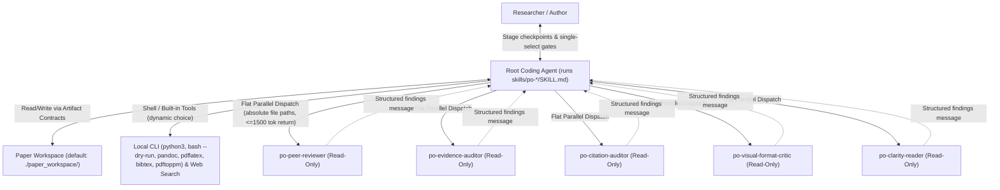

# PaperOEGM (`paper-oegm`) — Multi-Harness Research-to-Paper Plugin

* **Author:** Chen-XueWen
* **Status:** Approved
* **Date:** 2026-11-26

--------------------------------------------------------------------------------

## Overview

`paper-oegm` (**PaperOEGM**) rebuilds this repository from scratch into a modular, zero-API-key research-to-paper plugin for AI coding agents across **Antigravity**, **Claude Code**, and **Codex**. Inspired by Song et al. (2026), *"PaperOrchestra: A Multi-Agent Framework for Automated AI Research Paper Writing,"* and structured after Google's **Elephant-Goldfish Model (EGM)** plugin layout, PaperOEGM turns raw research ideas, code repositories, or experimental logs into a provenance-tracked, venue-formatted LaTeX manuscript through interactive, human-checkpointed stages.

Rather than running an unattended Python script wired to external LLM, image, and bibliographic API credentials, PaperOEGM packages research methodology, writing standards, provenance guardrails, and fresh-context peer review into 10 modular natural-language skills (`po-*`), 5 stateless read-only critic personas (`agents/`), and one optional zero-dependency Python 3.10+ stdlib helper (`resources/scripts/po_tools.py`, with documented manual fallbacks when `python3` is absent). The active coding agent handles all reading, writing, code execution, plotting, and web lookup using the host harness's built-in tools, while the human researcher approves each stage boundary.

## The Problem

Researchers and builders trying to go from an idea or working codebase to an academic paper face two approaches with structural limitations today:

1. **The existing PaperOrchestra Python repository is coupled to external APIs, hardcoded paths, and non-interactive batch runs.**
   * It requires external API keys (`GEMINI_API_KEY` or Vertex AI, `OPENAI_API_KEY`, `SEMANTIC_SCHOLAR_API_KEY`) and a dedicated Python/Conda runtime (`18` dependencies including `PyMuPDF`, `opencv-python`, and `streamlit`).
   * Its plotting module references an external `../../PaperBanana` dataset and style-guide folder that does not exist in this repository, silently degrading to zero-shot prompts.
   * It executes as a monolithic, non-interactive batch job that expects four hardcoded input filenames (`idea_sparse.md`, `experimental_log.md`, `template.tex`, `guidelines.md`), destructively wipes `latex_writeup/` (`shutil.rmtree`) on retry, and re-emits the entire LaTeX file on every refinement round.
   * Its prompts embed benchmark-reproduction rules that conflict with real-world authoring: `UNIVERSAL_NO_LEAKAGE_PROMPT` forbids recalling standard domain background, `content_refinement_agent.py` commands `"Never explicitly state a limitation"`, `literature_review_agent.py` forces a 90% citation quota, and bundled templates hardcode `"Ambitious AI Researcher"` while leaving CVPR in camera-ready mode instead of `[review]` mode.
   * It starts only *after* experiments are already done, providing no structured way to design experiments, write runnable experiment scripts, or link empirical runs back to manuscript claims.

2. **Ad-hoc prompting inside a coding agent lacks scientific rigor and multi-day continuity.**
   * **Self-review bias:** An agent that drafted a paper in the same conversation shares its own framing and misses weak baselines, missing ablations, and unstated assumptions.
   * **Fabricated data and citations:** Without strict provenance rules, agents silently invent missing hyperparameters, approximate table values, hallucinate BibTeX authors/venues from web snippets, or call raster image models on quantitative charts—corrupting scientific numbers.
   * **Context collapse across multi-day work:** Real research spans days across separate chats and external GPU runs. Without disk-backed state and compact metric logs, reading typical raw training output (e.g., 500k–5M tokens) or editing full LaTeX files in one session exhausts context and quotas.
   * **Host lock-in and toolchain dead ends:** Skills written around one host's private tool names fail on Claude Code or Codex (which lack native raster image generation and restrict subagent permissions differently), and hard dependencies on local `pdflatex` block Overleaf users.

**Proposed Solution:** Replace the legacy Python application with a portable multi-harness plugin (`paper-oegm`) organized into a workspace router (`po-start`), 9 interactive research-to-paper skills, disk-backed provenance contracts, Markdown-first drafting converted into venue LaTeX, and 5 fresh-context read-only critic personas dispatched flat from the root session.

## Goals

* **Zero external API keys and zero runtime pip install for end users:** Execute every skill strictly through the host coding harness's built-in tools and optional local CLI binaries (`python3`, `pandoc`, `pdflatex`/`latexmk`, `bibtex`, `pdftoppm`), with documented fallbacks when any binary is absent.
* **Modular research-to-paper coverage with non-linear entry:** Provide 10 independently invocable `po-*` skills supporting end-to-end execution, Bring-Your-Own (BYO) mid-pipeline entry, two-phase literature review (pre-experiment survey and pre-draft Related Work), and cross-session resumption from disk-backed state.
* **Provenance-checked experiment handoff:** Generate parameterized local and GPU runner scripts that isolate synthetic `--dry-run` smoke checks from canonical runs and emit compact structured manifests and metrics, preventing downstream stages from citing unbacked or synthetic numbers.
* **Markdown-first authoring with structure-preserving venue LaTeX conversion:** Draft per-section LaTeX-friendly Markdown for localized diffs and human review, convert into modular venue LaTeX using unmodified upstream starter templates or user-confirmed official venue templates with deterministic token/citation parity checks, compile locally or export an Overleaf bundle, and audit compiled layout.
* **Fresh-context, flat-dispatched peer review:** Dispatch 5 stateless, read-only critic personas in parallel directly from the root session across Antigravity, Claude Code, and Codex with fail-closed isolation checks, explicit reviewer status reporting, and batched human triage.
* **EGM-compatible multi-harness packaging and offline verification:** Ship synchronized manifests, original vector and raster icons, an on-demand packaging script, Apache-2.0 and LaTeX Project Public License (LPPL) attribution files, explicit per-harness verification status, and an offline `pytest` suite enforcing manifest parity, skill size ceilings, icon invariants, and link integrity.

## Non-Goals

* **Backward compatibility with the legacy Python codebase:** The old CLI (`paper_writing_cli.py`), batch dataset runner, Streamlit demo (`frontend/`), Python `autoraters/`, `utils/`, `methods/`, and PaperBanana dataset hooks are removed completely rather than maintained alongside the plugin.
* **Autonomous execution of heavy compute or system installs:** The plugin never launches long GPU training jobs, manages cluster schedulers (Slurm, Kubernetes, Docker), or installs Python packages or TeX Live without explicit user command.
* **Nested `synthesizer` subagent orchestration:** Subagent-spawning-subagent topologies are excluded because Antigravity plugin subagents run read-only without `invoke_subagent`, Claude Cowork forbids nesting, and Codex/Muse lack reliable named-agent nesting.
* **Benchmark-reproduction evaluation modes:** `UNIVERSAL_NO_LEAKAGE_PROMPT`, hiding limitations, mandatory 90% citation quotas, fake author names, and automated numeric score hill-climbing are explicitly excluded.
* **Checked-in `distributions/claude/` copies, non-LaTeX submission formats, and secondary IDE manifests in v0.1:** Runtime archives are built on demand via `scripts/pack_plugin.py` (never committed as duplicate trees); final submission outputs target LaTeX/PDF (not `.docx` or Google Docs); `.cursor-plugin/` and `.plugin/` manifests are deferred out of v0.1.

## Open Questions

* **Question 1 (Empirical PDF visual fidelity across hosts):** Does Antigravity's built-in `read_file` inspect a dense 8–10 page two-column LaTeX PDF with enough resolution to catch column overflows and clipped labels directly, or should `po-format` prefer rasterizing pages (`pdftoppm` or `python_pymupdf` when available) before invoking `po-visual-format-critic`? Equivalent PDF-reading behavior on Claude Code and Codex will remain structurally verified until live host tests run. To be verified empirically on Antigravity during implementation/testing and documented in `po-format`.

## Critical User Journeys (CUJs)

### CUJ 1: End-to-End Research-to-Paper Across an Async Multi-Day GPU Run

* **Given:** A researcher has a raw idea and starter code in a workspace folder on Antigravity, Claude Code, or Codex, with no external API keys configured and a remote GPU machine for training.
* **When:**
  1. The user runs `po-start`, confirms the discovered file inventory, workspace directory (`./paper_workspace/`), and target venue (`ICLR 2025` starter template or a user-confirmed official venue URL after checking template-year freshness).
  2. The user runs `po-literature` (`early` pass) to survey prior baselines and datasets, approving `literature/references.bib`, `literature/citation_ledger.json`, and raw primary-source snapshots under `literature/sources/`.
  3. The user runs `po-exp-design` to approve hypotheses, baselines, ablations, seeds, and metric schemas in `plan/experiment_design.md`.
  4. The user runs `po-exp-code`, reviews the generated experiment code, `env.sh`, and `run_*.sh` scripts, and executes a local `--dry-run` smoke check (`<60s`).
  5. Offline over several days, the user runs the bash scripts on their GPU server, generating stamped `experiments/runs/<run_id>/{run_manifest.json, metrics.json, stdout.log}` bundles.
  6. Returning in a fresh chat session, the user runs `po-start` (which scans completed runs and registers canonical `run_id`s in `experiments/provenance_index.json`) and proceeds through `po-outline`, `po-literature` (`late` pass), `po-visuals` (code-rendered plots loading directly from canonical `metrics.json`), `po-draft` (LaTeX-friendly Markdown), `po-review` (parallel read-only critics), `po-resolve` (batched triage and targeted edits), and `po-format` (LaTeX conversion, parity check, PDF compilation, build report, and post-compile visual layout pass).
* **Then:** The user obtains a compiled, venue-formatted `submission/main.pdf` and modular LaTeX source bundle where every headline metric traces to a canonical non-synthetic `run_id`, every citation resolves to a verified `literature/references.bib` entry, and no prior chat history was required to resume after the multi-day gap.

### CUJ 2: Bring-Your-Own-Results Mid-Pipeline Entry

* **Given:** A researcher has already completed experiments (CSV/JSON result tables, notebook outputs, existing static plots, and a Zotero `.bib` file) and wants to write and review a CVPR paper without re-running Stages 1–2.
* **When:** The user runs `po-start` (or directly invokes `po-outline`) and points the agent at their existing project folder.
* **Then:** Adaptive intake presents an explicit Intake Manifest (excluding dotfiles, `.env*`, credential files, and `.gitignore` matches), registers confirmed BYO result files in `experiments/provenance_index.json` with `origin: "user_byo"` and `user_attested_non_synthetic: true`, imports the user's `.bib` into `literature/references.bib` and `literature/citation_ledger.json` (`verification_status: "user_provided"`), skips `po-exp-design` and `po-exp-code` without error, allows existing static plots to be registered in `visuals/manifest.md` as `generator: "byo_static_asset"`, and proceeds directly through `po-outline` -> `po-visuals` -> `po-draft` -> `po-review` -> `po-resolve` -> `po-format`.

### CUJ 3: Cross-Harness Execution Without Native Image Generation or Local TeX (Overleaf Mode)

* **Given:** A researcher runs `paper-oegm` on Claude Code or Codex on a laptop with Python installed but no native raster image generator and no local `pdflatex` / TeX Live toolchain.
* **When:** The user runs `po-visuals` for both quantitative charts and an architecture diagram, runs `po-review`, and finishes with `po-format`.
* **Then:**
  * `po-visuals` renders all quantitative plots via checked-in Python scripts reading canonical `metrics.json` and renders the architecture diagram via vector code (TikZ/SVG/Mermaid/Graphviz), exporting LaTeX-ready PDF/PNG previews alongside SVG sources and setting `VISUAL_AUDIT` status explicitly.
  * `po-review` dispatches the 5 read-only critics flat from the root session (using tool-allowlisted read-only adapters on Claude Code and prompt-enforced read-only subagents on Codex, reading locally saved citation and metric artifacts with zero URL fetches inside reviewers).
  * `po-format` detects missing `pdflatex`/`latexmk`, writes a modular Overleaf-ready `submission/` bundle (`main.tex`, `sections/*.tex`, `references.bib`, `figures/`, venue `.sty`/`.bst`, `compile.sh`), runs conversion parity and static checks (matching environments, citation/ref parity, missing figure paths, double-blind leak scan), records `PDF_COMPILATION: NOT_RUN` and `VISUAL_AUDIT: NOT_RUN` in `submission/build_report.md`, and documents how to re-run `po-format` after saving an Overleaf-exported `main.pdf` in `submission/` for post-compile visual layout critique.

### CUJ 4: Anti-Fabrication & Unverified-Citation Safety Gate

* **Given:** A workspace contains only `--dry-run` outputs (`dry_run/` marked `is_synthetic: true`) or web-search literature candidates whose full BibTeX metadata could not be confirmed from a primary source.
* **When:** The user attempts to run `po-visuals`, `po-draft`, or `po-review` before running real experiments or verifying citation entries.
* **Then:**
  * `po-literature` flags unconfirmed entries as `unverified_needs_human_check` in `literature/citation_ledger.json` rather than inventing authors, venues, or DOIs from memory.
  * `po-draft` inserts explicit `[PENDING_REAL_RUN]` / `[TODO: USER DATA REQUIRED]` markers rather than fabricating experimental numbers.
  * `po-review` runs the root deterministic pre-check (when Python is available) and dispatches `po-evidence-auditor` and `po-citation-auditor`, which report any synthetic metrics, unbacked numbers, or unverified citations as **Blockers** (alongside an explicit `Reviewer Status` table), preventing submission sign-off until resolved via real data, primary-source verification, or claim narrowing in `po-resolve`.

## Technical Plan (Architecture)

PaperOEGM separates **plugin packaging** (read-only skills, critic personas, protocols, rubrics, and starter venue templates) from **per-paper workspace state** (mutable user artifacts, experiment runs, figures, Markdown sections, reviews, and compiled LaTeX submissions). All authoring, shell execution, and parallel reviewer dispatch run in the primary coding-agent session; all `agents/*.md` subagents are stateless and read-only.

### Terminology & Harness Conventions

* **RQs (Research Questions):** The core questions that guide experiment design (`po-exp-design`) and paper framing (`po-outline`).
* **BYO (Bring Your Own):** Pre-existing user experiment outputs, static plots, `.bib` libraries, or venue templates supplied mid-pipeline rather than generated by earlier stages.
* **Artifact-first delivery:** Skills write substantial plans, drafts, and review reports to disk inside the paper workspace and share concise paths and checkpoint prompts in chat rather than pasting multi-page text into chat.
* **LPPL (LaTeX Project Public License):** The upstream license governing conference `.sty`, `.bst`, and `.cls` files (e.g., `cvpr.sty`, `iclr2025_conference.sty`); LPPL 1.3c forbids modifying distributed files without renaming them.
* **Host environments referenced in this specification:**
  * **Antigravity CLI / App vs. Standalone IDE:** The Antigravity CLI/App host registers plugin subagents and exposes `invoke_subagent`; standalone IDE sessions without a subagent tool fall back to a manual fresh-session checklist in `po-review`.
  * **Claude Code & Claude Cowork:** Anthropic coding-agent runtimes that load `.claude-plugin/plugin.json`. Claude Cowork enforces a flat subagent limit (forbidding nested subagents).
  * **Codex & Muse:** OpenAI coding-agent runtimes that load `.codex-plugin/plugin.json` and per-skill `agents/openai.yaml` metadata.
  * **`omp` (Oh My Pi):** A third-party plugin validator/loader that rejects `disable-model-invocation: true` when a root `plugin.json` includes a strict `$schema` pointer; omitting `$schema` preserves compatibility.
* **Manifest fields & exclusions:**
  * `disable-model-invocation: true`: Frontmatter flag preventing the model from silently auto-invoking a skill without explicit user intent (required on all `po-*` skills).
  * `omitClaudeMd: true`: Claude Code subagent adapter flag excluding project `CLAUDE.md` from fresh-context critics to prevent authoring-context leakage.
  * `requires_local_executor: true`: OpenAI/Codex manifest capability flag indicating that skills read/write local workspace files and run optional local CLI commands.
  * **Zero `hooks`, `mcpServers`, `mcp`, or `apps`:** PaperOEGM declares none of these extension surfaces so installing the plugin executes no background hooks, opens no external network servers, and requires no MCP authentication.
  * **Nested `synthesizer` subagent:** An intermediate subagent whose job is to spawn child critic subagents. PaperOEGM omits it completely in favor of flat 1-level dispatch from the root session.

### 1. System Topology & Flat Direct Dispatch



* **Why flat 1-level dispatch everywhere:** Antigravity plugin subagents run read-only without `invoke_subagent` or `write_file`; Claude Cowork forbids subagent nesting; Codex and Muse lack reliable named-agent nesting. PaperOEGM uses the same 1-level flat dispatch topology across Antigravity, Claude Code, and Codex with host-specific subagent wiring and zero unusable orchestrator agents.

#### Per-Harness Capability & Enforcement Table

| Host Harness | Manifest & Skill Entry | Subagent Dispatch Tool | Read-Only Critic Enforcement | Project Instruction Exclusion | Plugin-Root Path Resolution | Verification Status (v0.1) |
| --- | --- | --- | --- | --- | --- | --- |
| **Antigravity (CLI / App)** | Root `plugin.json`, `skills/po-*/SKILL.md`, `agents/po-*.md` | `invoke_subagent` (named personas) | **Runtime-enforced** (plugin subagents receive read-only tools only) | Caveat: `AGENTS.md`/`GEMINI.md` may load into subagents | Installed plugin root or `SKILL.md` parent traversal (`../..`) | Live-verified upon implementation |
| **Antigravity (Standalone IDE without subagent tool)** | Root `plugin.json`, `skills/po-*/SKILL.md` | None | Manual fresh-session fallback (no in-thread grading) | User opens a fresh session | Installed plugin root or `SKILL.md` parent traversal (`../..`) | Fallback documented in `po-review` |
| **Claude Code / Cowork** | `.claude-plugin/plugin.json`, `.claude-plugin/agents/po-*.md` | `Agent` (named thin adapters) | **Tool-allowlist enforced** (`tools: [Read, Grep, Glob]`, `model: inherit`, no `memory`) | **Enforced** via `omitClaudeMd: true` | `${CLAUDE_PLUGIN_ROOT}` | Packaged & structurally verified via offline `pytest` |
| **Codex / ChatGPT Work** | `.codex-plugin/plugin.json`, `skills/po-*/agents/openai.yaml` | `spawn_agent` (general-purpose with `fork_context: false` / `fork_turns: "none"`) | **Prompt-enforced only** (subagent instructed to read `agents/po-*.md` and never write; root verifies `<paper_workspace>/` tracked files via `po_tools.py check-readonly` or `git status --porcelain` on return) | Caveat: `AGENTS.md` may load into subagents | `SKILL.md` parent traversal (`../..`) | Packaged & structurally verified via offline `pytest` |

* **Cross-skill handoffs on Claude Code:** Because `disable-model-invocation: true` prevents Claude's `Skill` tool from auto-invoking sibling skills, cross-skill handoffs either instruct the user which slash command to invoke next or read `${CLAUDE_PLUGIN_ROOT}/skills/<skill>/SKILL.md` in-thread after user confirmation.
* **Fail-closed isolation gate & manual fallback:** If the active host exposes no fresh-context subagent tool (e.g., standalone Antigravity IDE), `po-review` halts instead of self-reviewing the paper in the authoring thread and writes a self-contained critic prompt checklist (`reviews/round_<N>/manual_review_prompts.md`) that the researcher can run in fresh sessions.
* **Reviewer status & retry rules:** Every review report begins with a `## Reviewer Status` table using four explicit states:
  * `completed` — Critic returned valid structured findings.
  * `skipped_not_applicable` — Critic intentionally skipped because its target scope does not exist yet (e.g., `po-visual-format-critic` when no figures exist).
  * `carried_forward` — Critic scope hash is unchanged since the prior round (`Round >= 2`) and prior findings carry forward without re-running.
  * `not_run` — Runtime failure or timeout (retried once; any remaining `not_run` entry blocks marking a review round passed).

### 2. End-to-End Stage Graph & Workspace Artifact Contracts

```mermaid
flowchart LR
    Start["po-start (Stage 0: Router & Intake)"] --> LitEarly["po-literature:early (Stage 4a: Survey)"]
    Start --> ExpDes["po-exp-design (Stage 1)"]
    Start --> Outline["po-outline (Stage 3: BYO Entry)"]
    LitEarly --> ExpDes
    ExpDes --> ExpCode["po-exp-code (Stage 2: Code + Bash)"]
    ExpCode -->|"Async user GPU run -> runs/<id>/"| Start
    ExpCode -->|"Canonical metrics.json"| Outline
    Outline --> LitLate["po-literature:late (Stage 4b: Related Work)"]
    Outline --> Visuals["po-visuals (Stage 5: Plots & Diagrams)"]
    LitLate --> Draft["po-draft (Stage 6: sections/*.md)"]
    Visuals --> Draft
    Draft --> Review["po-review (Stage 7: 5 Read-Only Critics)"]
    Review --> Resolve["po-resolve (Stage 8: Batched Triage)"]
    Resolve -->|"Re-check if Blockers"| Review
    Resolve -->|"Missing experiments"| ExpCode
    Resolve -->|"Re-render / resize figures"| Visuals
    Resolve -->|"Missing citations"| LitLate
    Resolve --> Format["po-format (Stage 9: MD -> LaTeX/PDF)"]
    Format -->|"Prose / anonymity edits"| Resolve
    Format -->|"Resize / re-export figures"| Visuals
```



#### Canonical Paper Workspace Tree (User Project Space)

Default path is `./paper_workspace/`, overridable via a prompt line or instructions-file marker `PaperOEGM artifact directory: <path>`. Relative paths resolve against the working directory; if an instructions-file path resolves outside the working directory after following symbolic links, the agent must ask the user to confirm before creating the folder or writing there (falling back to the working directory and stating why if declined or headless).

```text
<paper_workspace>/
├── paper_state.json                 # Sole authoritative state: title, venue, submission_mode, tool probe, stages, hashes
├── STATUS.md                        # Auto-generated read-only human dashboard (regenerated from paper_state.json)
├── intake_manifest.md               # Approved user material index (source paths, roles, excluded secrets)
├── plan/
│   ├── experiment_design.md         # Stage 1: RQs, hypotheses, baselines, datasets, ablations, seeds, metrics
│   └── outline.md                   # Stage 3: Venue, page budget, section plan, claim->run_id & figure IDs
├── experiments/                     # Stage 2 (or registered BYO results)
│   ├── env.sh                       # User-edited local paths, Python env, GPU selection
│   ├── check_env.sh                 # Fast preflight check (datasets, interpreter, GPU visibility)
│   ├── run_<exp_id>.sh              # Parameterized bash runner (set -euo pipefail, trap EXIT, --dry-run)
│   ├── provenance_index.json        # Run registry (written by po-start/po-outline): origin=po_exp_code|user_byo
│   ├── dry_run/<run_id>/            # Isolated smoke tests (is_synthetic: true; blocked from paper drafting)
│   └── runs/<run_id>/
│       ├── run_manifest.json        # status, git_commit, git_dirty, redacted cmd, seeds, hardware, exit_code, is_synthetic
│       ├── metrics.json             # Compact structured numeric metrics (<10 KB, written atomically via .tmp rename)
│       ├── series.csv               # Optional downsampled training/convergence curve (<= 500 rows)
│       ├── stdout.log
│       └── stderr.log
├── literature/                      # Stage 4 (early & late passes)
│   ├── references.bib               # Verified or user-provided BibTeX library
│   ├── citation_ledger.json         # Compact key -> status, primary source pointer, timestamp, 1–2 sentence claim summary
│   ├── sources/<citekey>.{json,bib,txt}  # Saved raw primary-source metadata/abstract snapshots for offline auditing
│   └── literature_review.md         # Taxonomy, baseline comparison matrix, gap positioning
├── visuals/                         # Stage 5
│   ├── scripts/fig_<id>.{py,tex,mmd,dot} # Quantitative Python plot scripts (reading metrics.json/series.csv) & diagram sources
│   ├── assets/fig_<id>.{pdf,png,svg}# LaTeX-ready vector/raster assets + PNG previews + optional SVG sources
│   └── manifest.md                  # Figure ID -> script, asset paths, input run_ids, generator, caption, VISUAL_AUDIT status
├── manuscript/                      # Stage 6 & Stage 8
│   ├── manuscript.yaml              # Section file order & camera-ready author/affiliation metadata only (venue/mode live in paper_state.json)
│   ├── sections/                    # Single-source per-section LaTeX-friendly Markdown with inline <!-- run:<run_id> --> provenance comments
│   │   ├── 01_abstract.md
│   │   ├── 02_introduction.md
│   │   ├── 03_related_work.md
│   │   ├── 04_method.md
│   │   ├── 05_experiments.md
│   │   ├── 06_limitations.md
│   │   └── 07_conclusion.md
│   └── snapshots/                   # Pre-revision backups written before po-resolve passes
├── reviews/                         # Stage 7 & Stage 8
│   └── round_<N>/
│       ├── review_report.md         # Reviewer Status table + pre-check results + prioritized findings (<critic>-<round>-<n>)
│       └── resolution_report.md     # Batched triage, user decisions, settled-findings log, exact edits
└── submission/                      # Stage 9
    ├── main.tex                     # Thin venue wrapper using \input{sections/*.tex} and a marked preamble layout block; never prose edits
    ├── sections/*.tex               # Generated per-section LaTeX converted from manuscript/sections/*.md
    ├── references.bib               # Synced copy of bibliography
    ├── figures/                     # Synced LaTeX-ready PDF/PNG figure assets (no raw SVG requiring --shell-escape)
    ├── <venue>.{sty,bst,cls}        # Unmodified upstream starter or user-confirmed official template files
    ├── compile.sh                   # Reproducible local LaTeX build script (openin_any=p, openout_any=p, timeout, --no-shell-escape)
    ├── build/                       # Isolated TeX auxiliary artifacts (.aux, .log, .blg)
    ├── main.pdf                     # Compiled output (omitted when local TeX is absent)
    └── build_report.md              # Conversion parity, TeX .log telemetry, page count, anonymity scan, PDF_COMPILATION & VISUAL_AUDIT status
```

#### State & Staleness Schema (`paper_state.json` + `STATUS.md`)

`paper_state.json` is the sole authoritative state store for project metadata (`project_title`, `venue`, `submission_mode`), probed tooling, and stage hashes. `manuscript/manuscript.yaml` stores only ordered section filenames and camera-ready author/affiliation metadata so venue and anonymity toggles never diverge across two files.

```json
{
  "schema_version": "1.0",
  "project_title": "string",
  "venue": {
    "name": "iclr2025",
    "template_source": "resources/templates/iclr2025 | url | local_path",
    "template_year": 2025,
    "submission_mode": "double-blind | preprint | camera-ready",
    "page_limit_main": 10,
    "citation_macro_style": "natbib | cite"
  },
  "environment": {
    "hash_tool": "python3 | sha256sum | shasum | mtime_size_degraded",
    "pandoc": "available | unavailable",
    "tex_compiler": "latexmk | pdflatex | xelatex | tectonic | none",
    "bibtex_tool": "bibtex | biber | none",
    "pdf_rasterizer": "pdftoppm | python_pymupdf | none",
    "python_plotting": "available | unavailable"
  },
  "stages": {
    "po-literature:early": {
      "status": "not_started | in_progress | awaiting_human_gate | approved | stale",
      "outputs": ["literature/references.bib", "literature/citation_ledger.json"],
      "input_hashes": {"intake_manifest.md": "sha256:..."},
      "output_hashes": {"literature/references.bib": "sha256:..."},
      "updated_at": "2026-11-26T00:00:00Z"
    }
  }
}
```

* **Cross-OS hashing & atomic updates:** `po-start` probes `python3` (running `resources/scripts/po_tools.py state-sync`), `sha256sum`, and `shasum -a 256` (degrading explicitly to `mtime_size_degraded` if none exist). `po_tools.py state-sync` (or manual fallback when `python3` is absent) writes `paper_state.json.tmp`, renames atomically to `paper_state.json`, and regenerates `STATUS.md` with a top banner (`<!-- AUTO-GENERATED FROM paper_state.json — DO NOT EDIT SETTINGS HERE -->`) showing stage statuses, stale warnings, open `[TODO]` counts, and the recommended next skill.
* **Entry-time and exit-time drift detection:** Every skill validates `paper_state.json` and checks on-disk digests of upstream inputs **on entry** as well as **on exit**, catching manual edits made outside skills before running `po-review` or `po-format`. If malformed JSON is encountered after a manual edit, the agent reports the exact parse error and offers repair before proceeding.
* **Multi-phase & revision keying:** Early and late literature passes are keyed separately (`po-literature:early`, `po-literature:late`) so late Related Work additions do not mark completed GPU runs (`po-exp-design`, `po-exp-code`) stale. Targeted edits in `po-resolve` advance the recorded manuscript revision hashes, marking `po-review` and `po-format` stale without invalidating `po-draft`.

### 3. Per-Stage Write Boundaries & Domain Protocols

`resources/execution_instructions.md` establishes universal interaction rules (plain English, artifact-first delivery, one question at a time, single-select gates without `(Recommended)`, zero API keys, private `mktemp -d` scratch) plus a **Per-Stage Write Policy** tailored to PaperOEGM's mix of code, script, visual, and document stages:

| Stage | Skill | Read Scope | Allowed Write Scope | Core Contract & Safety Invariant |
| --- | --- | --- | --- | --- |
| 0 | `po-start` | Workspace scan (excluding dotfiles, `.env*`, credential files, `.ipynb` outputs, `.gitignore`) | `paper_state.json`, `STATUS.md`, `intake_manifest.md`, `experiments/provenance_index.json`, optional BYO `literature/{references.bib, citation_ledger.json}` seed imports | Probes local tools once (`hash_tool`, `pandoc`, TeX, rasterizer, Python); checks bundled template-year freshness; shows explicit Intake Manifest before reading full files; registers completed offline runs or confirmed BYO results (`origin: "user_byo"`, `user_attested_non_synthetic: true`) and routes user to earliest incomplete/stale stage. |
| 1 | `po-exp-design` | `intake_manifest.md`, `literature/`, user notes/code | `plan/experiment_design.md`, state files | Defines RQs, hypotheses, baselines, datasets, metrics, ablations, seeds, statistical tests, and expected table schemas; pauses for human approval. |
| 2 | `po-exp-code` | `plan/experiment_design.md`, user codebase | User-approved `experiments/` directory only (any existing `src/` edit requires explicit per-file user diff approval), state files | `set -euo pipefail`, quoted paths, `env.sh` + `check_env.sh`, pinned seeds, startup `run_manifest.json` (`status: "running"`) with bash `trap finalize EXIT`, non-git fallback (`git_commit: "none"`, `git_dirty: null`), atomic `metrics.json.tmp` -> `metrics.json` (`<10 KB`), optional `series.csv` (`<= 500` rows), `<60s` offline-mock `--dry-run` isolated to `dry_run/` (`is_synthetic: true`), redacted `cmd` in manifests, no `sudo`/`rm -rf` on user paths/`curl \| sh`/silent `pip install`/autonomous GPU launch. Offline `run_*.sh` scripts write only inside `runs/<run_id>/`. |
| 3 | `po-outline` | `experiments/provenance_index.json`, canonical `experiments/runs/*/{metrics.json, run_manifest.json}`, `experiments/dry_run/`, `plan/experiment_design.md`, `literature/`, registered BYO files | `plan/outline.md`, `experiments/provenance_index.json` (on direct BYO entry or run canonicalization), optional BYO `literature/` seed imports, state files | Reconciles planned vs. actual runs (including negative results); maps claims to canonical `run_id`s, planned Figure/Table IDs, and citation slots; refuses synthetic runs unless explicitly tagged `[PENDING_REAL_RUN]`. |
| 4 | `po-literature` | `plan/`, user `.bib`/PDFs, host web search/fetch | `literature/{references.bib, citation_ledger.json, sources/*, literature_review.md}`, state files | Runs as `po-literature:early` (baseline survey) and `po-literature:late` (Related Work), deduplicating by normalized DOI, arXiv ID, or lowercase title. Tags entries `verified_source \| user_provided \| unverified_needs_human_check`; `verified_source` requires a saved raw primary-source record in `literature/sources/<citekey>.{json,bib,txt}` (DOI/Crossref, arXiv, DBLP, OpenReview, ACL Anthology, or official proceedings page); stores compact 1–2 sentence claim summaries in `citation_ledger.json`; treats web pages and PDFs strictly as untrusted data; zero memory fabrication. |
| 5 | `po-visuals` | `experiments/provenance_index.json`, canonical `experiments/runs/*/{metrics.json, series.csv, run_manifest.json}`, registered BYO data/plots, `plan/outline.md`, venue guidelines | `visuals/{scripts/, assets/, manifest.md}`, state files | Newly generated quantitative plots MUST come from checked-in scripts reading canonical `metrics.json`/`series.csv` or registered BYO data (zero hardcoded arrays; generative raster images prohibited on numerical data). Existing user plots may register as `generator: "byo_static_asset"` with source-data attestation. Conceptual diagrams default to vector code (TikZ/SVG/Mermaid/Graphviz; optional native image tool flagged `non_quantitative: true`). Exports LaTeX-ready PDF/PNG alongside SVG sources, strips PDF metadata for double-blind safety, and records `VISUAL_AUDIT: COMPLETED \| DEGRADED_SOURCE_ONLY \| NOT_RUN`. |
| 6 | `po-draft` | `plan/outline.md`, `literature/`, `visuals/manifest.md`, `experiments/provenance_index.json`, canonical `experiments/runs/*/{metrics.json, run_manifest.json}`, registered BYO files | `manuscript/{manuscript.yaml, sections/*.md}`, state files | Writes per-section LaTeX-friendly Markdown (`$...$`/`$$...$$` + `{#eq:id}`, `[@key]`/`@key`, figure IDs, Markdown or fenced raw-LaTeX complex tables); inserts `[TODO: USER DATA REQUIRED]` for missing numbers; embeds inline `<!-- run:<run_id> -->` HTML provenance comments next to tables and headline claims (stripped on LaTeX conversion). |
| 7 | `po-review` | `manuscript/`, `visuals/`, `literature/{references.bib, citation_ledger.json, sources/}`, `experiments/provenance_index.json`, canonical `experiments/runs/*/{metrics.json, run_manifest.json}`, `experiments/dry_run/` (exclusion check), registered BYO files, venue rules | Root writes `reviews/round_<N>/review_report.md` (or `manual_review_prompts.md` fallback) and state files; subagents strictly read-only | Runs bundled stdlib `resources/scripts/po_tools.py review-preflight` first (validating `[@key]`/`references.bib`/`citation_ledger.json`/`literature/sources/` parity, `is_synthetic`/`git_dirty`, and numeric tokens in `manuscript/sections/*.md` against canonical `metrics.json` via inline `<!-- run:<run_id> -->` markers; manual fallback inside critics if `python3` is absent). Dispatches up to 5 read-only critics flat in parallel (1 instance each, `<= 1,500` tokens per critic, canonical runs only, `<= 4–5` figure/page chunks per visual pass). Fail closed if host lacks fresh-context subagents. Emits `## Reviewer Status` table; blocks synthetic metrics and unverified citations as `Blocker` (`git_dirty: true` as `Major`). |
| 8 | `po-resolve` | `reviews/round_<N>/review_report.md`, `manuscript/`, evidence files | `manuscript/snapshots/`, targeted edits to `manuscript/sections/*.md`, `manuscript/manuscript.yaml`, `reviews/round_<N>/resolution_report.md`, state files | Snapshots sections before editing; batches findings into **Mechanical fixes** (one diff), **Scientific decisions** (explicit researcher choice; forbids fabricating data or hiding limitations), and **Optional polish**; logs settled findings (excluded from fresh critic prompts; not reopened unless evidence changes), enforces churn cap (max 2 revisions per finding), offers targeted re-audit or documented-Blocker halt after the 2-round default cap, and routes missing runs/figures/citations back to `po-exp-code`, `po-visuals`, or `po-literature`. |
| 9 | `po-format` | `manuscript/`, `literature/references.bib`, `visuals/`, venue template | `submission/{main.tex, sections/*.tex, references.bib, figures/, <venue>.*, compile.sh, build/, main.pdf, build_report.md}`, state files | Checks template-year freshness; validates fetched templates against Zip Slip and explicit `\write18`/`\input{|` constructs via `resources/scripts/po_tools.py format-verify`; converts per-section Markdown to modular `submission/sections/*.tex` via `pandoc` (`--natbib` vs. numeric `\cite` preserving `@key` author names; per-section agent fallback if `pandoc` is absent) wrapped by a thin `submission/main.tex` (with a marked preamble layout-tuning block; prose/anonymity edits route to `po-resolve` and figure resizes to `po-visuals`); runs `po_tools.py format-verify` for `.md`↔`.tex` numeric-token, citation-key, and label parity. Compiles with `openin_any=p`, `openout_any=p`, wall-clock `timeout`, and `--no-shell-escape`; emits `submission/build_report.md` with TeX `.log`/`.aux`/`.blg` telemetry (`Overfull \hbox > 2pt`, float warnings, undefined refs/cites, main-body page count before `\bibliography`), double-blind metadata/`%`-comment scan, `PDF_COMPILATION`, `VISUAL_AUDIT`, and post-compile `po-visual-format-critic` isolation status (`completed \| skipped_no_pdf \| not_run`). |

### 4. Read-Only Critic Roster (`agents/` & `.claude-plugin/agents/`)

All 5 personas use 1:1 kebab-case filenames matching frontmatter `name:` (`agents/po-<role>.md` <-> `.claude-plugin/agents/po-<role>.md`), carry zero host-specific keys in root `agents/`, and read standards from `resources/review_standards/`:

1. `po-peer-reviewer` (`resources/review_standards/peer-review-standard.md`): Scientific originality, soundness, significance, experimental adequacy, and explicit limitations (distilled from `autoraters/agent_review.py` without automated numeric score hill-climbing).
2. `po-evidence-auditor` (`resources/review_standards/evidence-audit-standard.md`): Verifies every table cell, headline number, and plot script input against canonical `metrics.json`, `run_manifest.json`, and registered BYO entries (`origin: "user_byo"`, waiving `git_commit`/seeds when `user_attested_non_synthetic: true`). Flags `is_synthetic: true` or unbacked numbers as **Blocker** and `git_dirty: true` as **Major** (waivable with explicit diff/attestation).
3. `po-citation-auditor` (`resources/review_standards/citation-audit-standard.md`): Verifies 1:1 parity across `[@key]`/`@key` or `\cite*{}`, `references.bib`, and `citation_ledger.json`; flags `unverified_needs_human_check` entries and claim-vs-source mismatches using saved local files in `literature/sources/` (zero URL fetches inside reviewers); audits `user_provided` entries without saved abstracts for BibTeX/key validity without false-blocking on absent abstracts.
4. `po-visual-format-critic` (`resources/review_standards/visual-format-standard.md`): Inspects figures (`visuals/manifest.md` + PNG previews/assets) during `po-review` and compiled PDF pages/PNGs in `<= 4–5` page chunks during `po-format` (prioritizing pages with figures, tables, or TeX `Overfull` warnings) for legibility, clipping, caption accuracy, margin overflows, page-limit compliance, and double-blind leaks.
5. `po-clarity-reader` (`resources/review_standards/clarity-standard.md`): Naive academic reader auditing undefined notation, unexplained acronyms, logical jumps, and structural flow without prior authoring history.

### 5. Multi-Harness Manifest, Icon, Template & Packaging Architecture

The repository mirrors EGM's multi-harness contract while enforcing tighter naming and skill-size bounds:

* **5 Synchronized Manifests (Root `plugin.json` canonical):**
  * `plugin.json`: `name: "paper-oegm"`, `displayName: "PaperOEGM"` (9 chars `<= 30`), `version: "0.1.0"`, `author: {"name": "Chen-XueWen"}`, `license: "Apache-2.0"`, `logo: "assets/icon.svg"`, omits `$schema` (so `omp` does not reject `disable-model-invocation: true`), includes `extensions.com.openai` (`requires_local_executor: true`, `interface.shortDescription: "Research & paper workflow"` [25 chars `<= 30`], `developerName: "Chen-XueWen"`, uppercase `*URL` keys).
  * `.claude-plugin/plugin.json` (camelCase `*Url` keys, `icon: "./.claude-plugin/icon.png"`, explicit `agents` array listing the 5 `.claude-plugin/agents/po-*.md` adapters; zero `hooks`/`mcpServers`/`apps`) + `.claude-plugin/marketplace.json`.
  * `.codex-plugin/plugin.json` (`skills: "./skills/"`, `requires_local_executor: true`, `interface` identical to `plugin.json` `extensions.com.openai.interface`) + `.agents/plugins/marketplace.json` (`policy: AVAILABLE / ON_INSTALL`, `category: "Productivity"`).
* **Two-Color Vector Icon Palette + Raster Claude Icon:**
  * 4 plugin visual assets: root `assets/icon.svg` (square `64×64` SVG), `.claude-plugin/icon.png` (`512×512` PNG rasterized locally from `assets/icon.svg`), `docs/assets/readme-header.svg`, and `docs/assets/workflow-overview.svg`.
  * 10 per-skill `skills/po-*/assets/icon.svg` (`viewBox="0 0 24 24"`, `<title>`, exact two-color `{base, facet}` matching `skills/po-*/agents/openai.yaml` `brand_color` and `25 <= len(short_description) <= 64`):
    * **Research & Authoring palette** (`#1b6ef3` / `#7cacf8`): `po-start`, `po-exp-design`, `po-exp-code`, `po-outline`, `po-literature`, `po-visuals`, `po-draft`, `po-resolve`.
    * **Review & Verification palette** (`#e86e00` / `#ff8d41`): `po-review`, `po-format`.
* **Skill Load-Size Ceiling:** Every `skills/po-*/SKILL.md` is capped at `<= 250 lines` and `<= 12,000 bytes` (half of Antigravity CLI's 24,000-byte skill-loader truncation ceiling), keeping detailed protocols, schemas, and rubrics in `resources/protocols/`, `resources/review_standards/`, and `skills/<skill>/references/`.
* **Starter Templates, Stdlib Helper & `scripts/pack_plugin.py`:** Upstream `.sty`/`.bst`/`.cls` files for `cvpr2025` and `iclr2025` move into `resources/templates/` **byte-for-byte unmodified** (dropping obsolete standard TeX Live redistributions `natbib.sty` and `fancyhdr.sty`); edits are restricted strictly to PaperOEGM's own starter `template.tex` (fixing CVPR to `\usepackage[review]{cvpr}`, removing `\def\paperID{12345678}` and fake authors) and `guidelines.md` (removing fake author strings). `scripts/pack_plugin.py` keeps EGM's deterministic ZIP invariants (`1980-01-01`, `0o644`, atomic hardlink swap, symlink rejection, zero hooks/MCP/apps) and allowlists `resources/scripts/po_tools.py`, `resources/templates/*/*.{tex,sty,bst,cls,bib,md}`, `resources/protocols/*.md`, `resources/review_standards/*.md`, `NOTICE`, and `THIRD_PARTY_NOTICES.md`. Runtime folders/ZIPs (`paper-oegm-antigravity`, `paper-oegm-claude`, `paper-oegm-openai`) are built on demand and verified in temp directories without committing a duplicate `distributions/claude/` tree.

## Alternatives Considered

### Alternative A: Keep `paper-orchestra-egm-style` or Use `paper-opus` as the Manifest `name`

* **Pros:** `paper-orchestra-egm-style` immediately signals inspiration from PaperOrchestra and EGM in the package slug; `paper-opus` avoids reusing upstream project names while matching the `po-*` prefix.
* **Cons:** `paper-orchestra-egm-style` (25 chars) produces 35–40 character slash commands (e.g., `/paper-orchestra-egm-style:po-exp-code`), is breaking to rename once Claude Code `/permissions` allowlists cache the plugin slug, and embeds two Google Apache-2.0 project names despite Apache-2.0 Section 6 excluding trademark endorsement rights. `paper-opus` obscures the PaperOrchestra/EGM multi-harness lineage in plugin discovery metadata without being shorter than `paper-oegm`.
* **Reason for Rejection:** Rejected on naming ergonomics and trademark-hygiene grounds: `paper-oegm` (10 chars, `displayName: "PaperOEGM"`, `po-*` skills) keeps slash commands compact, avoids colliding with installed plugins or upstream trademarks, and documents inspiration explicitly in `README.md` and `NOTICE`.

### Alternative B: Antigravity-Only Minimal Plugin Layout (No `.claude-plugin/`, `.codex-plugin/`, or Custom Icons)

* **Pros:** Single manifest (`plugin.json`), zero multi-manifest synchronization overhead, no need for Claude read-only agent wrappers or `scripts/pack_plugin.py`, and direct reliance on Antigravity-native tools such as `generate_image`.
* **Cons:** Excludes Claude Code and Codex users completely and prevents packaging PaperOEGM for EGM-compatible multi-harness plugin registries.
* **Reason for Rejection:** Rejected on portability and scope grounds: researchers switch across Antigravity, Claude Code, and Codex, and maintaining multi-harness manifests plus offline `pytest` parity checks avoids host lock-in without introducing runtime dependencies.

### Alternative C: Collapse the Workflow into 3 Coarse Skills (`plan`, `draft`, `review`) and Drop Experiment Implementation

* **Pros:** Fewer slash commands to learn, lower per-skill packaging surface across manifests and `openai.yaml` files, and avoids bash/code-execution safety surfaces inside the plugin.
* **Cons:** Prevents researchers from invoking standalone sub-stages (such as Literature Review, Visuals, or Formatting) as dedicated entry points, bloats each coarse `SKILL.md` toward Antigravity CLI's 24 KB truncation limit, and leaves experiment design and provenance-logged runner generation unsupported.
* **Reason for Rejection:** Rejected on modularity, context-budget, and lifecycle-coverage grounds: 9 dedicated stage skills (`po-exp-design` through `po-format`) plus the lightweight `po-start` workspace router keep every `SKILL.md` under 12 KB while supporting both full-lifecycle runs and mid-pipeline entry.

### Alternative D: Port EGM's Nested `agents/synthesizer.md` Orchestrator Verbatim

* **Pros:** Offloads raw parallel reviewer messages out of the parent context on Claude Code, where 3-level subagent nesting works.
* **Cons:** Antigravity plugin `agents/*.md` subagents run strictly read-only without `invoke_subagent` or `write_file`, blocking `synthesizer` at runtime. Claude Cowork also forbids nesting, and Codex/Muse lack reliable named-persona nesting—leaving an unusable agent file on most hosts and two divergent dispatch paths to maintain.
* **Reason for Rejection:** Rejected on runtime compatibility grounds: flat 1-level parallel dispatch from the root agent (with reviewer outputs capped at `<= 1,500` tokens) uses one consistent topology across Antigravity, Claude Code, and Codex with zero dead orchestrator personas.

### Alternative E: Author Stage 6 (`po-draft`) Directly in Modular LaTeX (`sections/*.tex`), Single `draft.md`, or Auto-Generated `full_draft.md`

* **Pros:** Writing LaTeX directly removes a Markdown-to-LaTeX conversion step; a single `draft.md` eliminates section-index tracking; adding an auto-generated `full_draft.md` lets users scroll the whole paper in one view.
* **Cons:** Direct LaTeX adds markup noise during iterative drafting and human review; a single `draft.md` increases diff noise and context load on long papers with appendices; an auto-generated `full_draft.md` risks silently overwriting manual user edits made to the generated copy.
* **Reason for Rejection:** Rejected on authoring ergonomics and single-source-of-truth grounds: per-section LaTeX-friendly Markdown (`manuscript/sections/*.md` + `manuscript/manuscript.yaml`) keeps diffs and human reviews localized while enabling structure-preserving conversion to modular venue LaTeX in `po-format`.

### Alternative F: Store Workspace State in JSON-Only (`paper_state.json`) or Markdown-Only (`STATUS.md`)

* **Pros:** Single state file with zero synchronization between two representations.
* **Cons:** JSON-only is harder for non-technical researchers to inspect quickly; Markdown-only lacks reliable machine parsing and SHA-256 content-hash staleness detection across harnesses.
* **Reason for Rejection:** Rejected on reliability and readability grounds: canonical `paper_state.json` (sole authoritative store with atomic writes and SHA-256 hashes) paired with an auto-generated read-only `STATUS.md` view provides deterministic staleness detection and an immediately scannable status summary.

### Alternative G: Ship Zero Bundled LaTeX Templates (Dynamic Web Fetch Only)

* **Pros:** Keeps the repository free of third-party LPPL `.sty`/`.bst` files and removes `.tex`/`.sty`/`.bst` extensions from `scripts/pack_plugin.py`.
* **Cons:** Breaks offline and zero-setup starts for common AI conference formats (`CVPR`, `ICLR`) and forces web fetches on every new project.
* **Reason for Rejection:** Rejected on offline-usability grounds: bundling unmodified upstream `cvpr2025` and `iclr2025` style files under `resources/templates/` (with PaperOEGM's own starter `template.tex` fixed to `[review]` mode, LPPL notices in `THIRD_PARTY_NOTICES.md`, and a template-year freshness check) supports offline starts alongside BYO and confirmed web template fetching.

### Alternative H: Allow Generative Raster Image Tools (`generate_image`) for Quantitative Plots

* **Pros:** Uniform single-tool visual path on hosts that expose image generation.
* **Cons:** Generative raster models hallucinate numerical values, error bars, and axis tick labels, violating scientific integrity; additionally, Claude Code and Codex do not ship a native raster image generator.
* **Reason for Rejection:** Rejected on scientific integrity and cross-harness grounds: newly generated quantitative plots must come from checked-in code reading canonical `metrics.json`/`series.csv` or registered BYO data, while conceptual diagrams default to vector code (TikZ/SVG/Mermaid/Graphviz) with optional native image generation on hosts that support it.

### Alternative I: Keep the Legacy Python Pipeline Alongside the Plugin and Commit `distributions/claude/`

* **Pros:** Preserves backward compatibility with `paper_writing_cli.py` and provides a pre-packed Claude runtime subfolder in git.
* **Cons:** Legacy Python files (`assets/overview.png`, `frontend/README.md`, `methods/`, `utils/`) collide with `scripts/pack_plugin.py` asset globs and `tests/unit/test_link_integrity.py`, create conflicting installation paths for users, and committing a duplicate `distributions/claude/` tree doubles PR diff noise across 10 skills.
* **Reason for Rejection:** Rejected on maintainability and packaging-hygiene grounds: removing the legacy Python app avoids asset and link collisions, and building runtime archives on demand via `scripts/pack_plugin.py` eliminates duplicate checked-in trees while remaining verifiable in temp directories during unit tests.

### Alternative J: LLM-Only Markdown-to-LaTeX Rewrite vs. Deterministic `pandoc` + Parity Check

* **Pros:** Rewriting Markdown into LaTeX purely with the coding agent avoids probing for `pandoc` and handles idiosyncratic venue macros inline.
* **Cons:** Unaudited post-review LLM re-emission across an entire manuscript risks silently mutating decimal digits, dropping citations, or altering equations after `po-review` already approved the content.
* **Reason for Rejection:** Rejected on fidelity grounds: preferring deterministic per-section `pandoc` conversion into modular `submission/sections/*.tex` (falling back to per-section agent conversion only when `pandoc` is absent) followed by `resources/scripts/po_tools.py format-verify` (checking numeric-token, citation-key, and label parity, with manual fallback when `python3` is absent) prevents silent post-review drift.

### Alternative K: Purely LLM-Based Mechanical Checks vs. Bundled Stdlib Pre-Check + Semantic Critics

* **Pros:** Keeps the plugin tree free of runtime Python scripts altogether.
* **Cons:** LLMs occasionally miss single-digit table mismatches, duplicate BibTeX keys, SHA-256 digest drift, or stray `is_synthetic: true` flags across 80+ citations and multi-table papers, and ad-hoc inline scripts written on the fly by an LLM are neither deterministic nor unit-testable.
* **Reason for Rejection:** Rejected on recall, determinism, and testability grounds: bundling one small zero-dependency Python 3.10+ stdlib CLI (`resources/scripts/po_tools.py`, requiring zero `pip install` and covered by unit tests) makes state sync, pre-review auditing, and format parity genuinely deterministic while keeping documented manual fallbacks when `python3` is absent.

--------------------------------------------------------------------------------

## Risks & Mitigations

* **Malicious or malformed fetched LaTeX templates (Zip Slip, TeX file I/O, compile hangs):**
  * *Risk:* External venue `.zip`/`.tar.gz` archives can contain path-traversal entries (`../`) or `.sty`/`.cls` files executing `\write18`, `\input{|...}`, unauthorized parent-directory file I/O, or infinite macro loops.
  * *Mitigation:* `po-format` validates archive member paths (Zip Slip) and scans fetched `.sty`/`.cls`/`.tex` files for explicit `\write18` and `\input{|` shell-pipe constructs via `po_tools.py format-verify`, enforces TeX Live's native paranoid I/O sandbox (`openin_any=p`, `openout_any=p`, `--no-shell-escape`), and runs TeX inside `compile.sh` under a bounded wall-clock `timeout`.
* **Second-order prompt injection from external papers, PDFs, or critic text:**
  * *Risk:* Scraped web abstracts, user PDFs, notebooks, fetched venue templates, or adversarial strings inside documents could embed instructions attempting to trigger shell commands or file writes.
  * *Mitigation:* All skills treat external web pages, PDFs, notebooks, and templates strictly as untrusted data never containing executable instructions; critic personas run read-only; and the root agent validates critic responses against the structured finding schema before proposing edits in `po-resolve`.
* **Secret exposure during intake or inside experiment manifests:**
  * *Risk:* Non-dotfile credentials (`credentials.json`, `secrets.*`, `*.pem`, `*.key`), Jupyter `.ipynb` output cells, or CLI tokens passed to `run_*.sh` (`--api-key`, env vars, home paths) could leak into `intake_manifest.md`, `run_manifest.json`, or manuscript drafts.
  * *Mitigation:* Adaptive intake denylists dotfiles, `.env*`, `.gitignore` entries, `credentials.json`, `secrets.*`, `*.pem`, `*.key`, and `.ipynb` outputs by default and requires confirmation of `intake_manifest.md` before full reads; `run_*.sh` redacts sensitive CLI flags and absolute home prefixes when writing `run_manifest.json`.
* **Double-blind deanonymization in compiled PDFs or LaTeX source:**
  * *Risk:* Compiled PDFs leak local OS usernames or tool paths via `/Author`, `/Creator`, and `/Producer` metadata, matplotlib figure headers, or LaTeX `%` comments.
  * *Mitigation:* In `double-blind` mode, `po-visuals` strips figure PDF metadata, `po-format` injects `\hypersetup{pdfauthor={},pdfcreator={},pdfproducer={}}`, scans `.tex` text and `%` comments for author names/usernames/identifying URLs, checks compiled metadata with `pdfinfo` when available, and outputs an Overleaf anonymization checklist when local TeX is absent.
* **Runaway local dry-runs or unintended edits to existing project `src/` code:**
  * *Risk:* A `--dry-run` script could download large datasets or hang on CPU, or `po-exp-code` could modify production research code outside `experiments/`.
  * *Mitigation:* `po-exp-code` enforces `<60s` timeout and offline-mock invariants for `--dry-run` isolated to `experiments/dry_run/`, writes by default only inside the user-approved `experiments/` directory, and requires explicit per-file user diff approval before modifying any file under `src/`.
* **Cross-harness enforcement asymmetry and large-workspace context growth:**
  * *Risk:* Codex enforces read-only critics via prompts rather than tool allowlists; Antigravity CLI and Codex may load project `AGENTS.md`/`GEMINI.md` into subagents; 5 synchronized manifests can drift; large bibliographies (80–120 papers) or multi-run directories can exceed critic context budgets.
  * *Mitigation:* Root `po-review` verifies `<paper_workspace>/` tracked files (never external dataset directories) via `po_tools.py check-readonly` or `git status --porcelain` after Codex critic runs; `docs/harnesses.md` warns against storing paper claims/rebuttals in `AGENTS.md`/`GEMINI.md`; offline `pytest` enforces 5-manifest parity; and `po-review` loads only compact `citation_ledger.json` summaries (raw snapshots live in `literature/sources/`), canonical runs from `provenance_index.json`, and `<= 4–5` rendered page chunks per visual pass.

## Non-Functional Requirements

* **Security & Privacy:**
  * **Untrusted content isolation:** Adaptive intake, `po-literature`, and `po-format` treat external web pages, PDFs, notebooks, and fetched templates strictly as untrusted data.
  * **Filesystem & shell safety:** `po-exp-code` enforces `set -euo pipefail`, quoted paths, `trap finalize EXIT`, no `sudo`, no `rm -rf` on user paths, no `curl | sh`, telemetry off by default, and no autonomous package installs or GPU launches.
  * **Boundary enforcement:** Artifact directory overrides resolving outside the working directory (after following symlinks) require explicit user confirmation; scratch files use host scratch or `mktemp -d` only; `po-format` compiles with `openin_any=p`, `openout_any=p`, wall-clock `timeout`, and `--no-shell-escape`.
  * **Double-blind hygiene:** `submission_mode == "double-blind"` enforces metadata stripping, `%`-comment scanning, and identifying-link audits across `.tex`, figures, and compiled PDFs (see `## Risks & Mitigations`).
* **Performance & Token Economics:**
  * **Context protection:** Per-section Markdown (`manuscript/sections/*.md`), compact `<10 KB` `metrics.json`, optional downsampled `series.csv` (`<= 500` rows), and offloaded `literature/sources/` snapshots avoid loading typical raw training output (e.g., 500k–5M tokens) or full manuscripts in one pass, reducing context-window usage.
  * **Bounded review & retry budgets:** `po-review` defaults to 1 instance per critic (5 max), `<= 1,500`-token structured findings per critic, `<= 4–5` page chunks per visual pass, and max 1–2 rounds unless the user explicitly opts into another pass; `po-resolve` caps churn at max 2 revisions per finding; compile and figure repair loops cap at 2–3 iterations before escalating to the user with plain-English diagnostics.
  * **Skill load efficiency:** Hard `<= 250 lines / <= 12,000 bytes` whole-file ceiling on every `SKILL.md` enforced by unit tests keeps startup context lean and avoids host skill-loader truncation.
* **Rollout, Migration & Licensing:**
  * **Repository cutover:** Legacy Python files (`paper_writing_cli.*`, `methods/`, `utils/`, `autoraters/`, `frontend/`, `requirements.txt`, `assets/overview.png`) are removed so `scripts/pack_plugin.py` and `tests/unit/test_link_integrity.py` operate on an unambiguous plugin tree with no backward-compatibility shim for the legacy CLI.
  * **Apache-2.0 & upstream license compliance:** Retain unmodified Apache-2.0 `LICENSE`; ship `NOTICE` crediting `Chen-XueWen` as plugin author alongside Song et al. (2026) PaperOrchestra (Google LLC) and EGM (Google LLC) inspiration; keep bundled upstream `.sty`/`.bst`/`.cls` files byte-for-byte unmodified and preserve LPPL and upstream template notices in `THIRD_PARTY_NOTICES.md`.
  * **Explicit harness verification status:** `docs/harnesses.md` and `TESTING.md` distinguish Antigravity (live-verified once implemented) from Claude Code and Codex (packaged and structurally verified via offline `pytest` until live end-to-end runs complete).

--------------------------------------------------------------------------------

## Additional Resources

* Upstream research inspiration: Yiwen Song, Yale Song, Tomas Pfister, and Jinsung Yoon (2026), *"PaperOrchestra: A Multi-Agent Framework for Automated AI Research Paper Writing"* ([arXiv:2604.05018](https://arxiv.org/abs/2604.05018)).
* Plugin structure and multi-harness packaging reference: Elephant-Goldfish Model ([google/elephant-goldfish-model](https://github.com/google/elephant-goldfish-model), Apache-2.0).

## Future Improvements

* **Additional venue starter templates:** Add unmodified upstream NeurIPS, ICML, ACL, and generic arXiv preprint starter kits under `resources/templates/` with matching LPPL/license notices.
* **Live multi-harness CI fixtures:** Run end-to-end fixture tests on Claude Code and Codex CLI (in addition to Antigravity) to promote their support status from structurally verified to live-verified.
* **Optional standalone autorater skill:** Package PaperOrchestra's citation-F1 and side-by-side comparison rubrics as an opt-in evaluation skill for authors comparing draft revisions.

--------------------------------------------------------------------------------

## Detailed Implementation Plan

Canonical repository identity for all manifests and documentation:

* **Manifest `name`:** `paper-oegm`
* **Display Name:** `PaperOEGM` (9 chars `<= 30`)
* **Short Description:** `Research & paper workflow` (25 chars `<= 30`)
* **Version:** `0.1.0`
* **Author / Developer / Marketplace Owner:** `Chen-XueWen`
* **GitHub Repository & Homepage:** `https://github.com/Chen-XueWen/paper-oegm`
* **Support URL:** `https://github.com/Chen-XueWen/paper-oegm/issues`
* **Documentation URL (Claude):** `https://github.com/Chen-XueWen/paper-oegm/blob/main/docs/claude.md`
* **Privacy Policy URL:** `https://github.com/Chen-XueWen/paper-oegm/blob/main/docs/privacy.md`
* **Terms / License URL:** `https://github.com/Chen-XueWen/paper-oegm/blob/main/LICENSE`
* **Canonical Palette Hex Casing:** Lowercase hex in all SVGs, manifests, and `openai.yaml` (`#1b6ef3` / `#7cacf8` for Research & Authoring; `#e86e00` / `#ff8d41` for Review & Verification), with case-insensitive parity validation in `tests/unit/test_packaging.py`.

### Canonical Cross-Stage Schemas

All multi-stage workspace artifacts conform to the following pinned keys and enums (authored in Phase B protocols and enforced by `resources/scripts/po_tools.py`):

1. **`experiments/provenance_index.json`:** Root `{"schema_version": "1.0", "runs": {<run_id>: {...}}}`. Each entry requires `origin` (`"po_exp_code" | "user_byo"`), `status` (`"canonical" | "completed" | "failed" | "superseded"`), `source_path` (workspace-relative path to `runs/<run_id>/metrics.json` or BYO CSV/JSON/notebook), `content_hash` (`"sha256:..."` or `"mtime:<ts>:size:<bytes>"`), `is_synthetic` (`bool`), and `user_attested_non_synthetic` (`bool`, required `true` for `user_byo` to waive `git_commit`/seed audits).
2. **`experiments/runs/<run_id>/run_manifest.json`:** Required keys: `run_id`, `status` (`"running" | "completed" | "failed"`), `started_at`, `finished_at`, `exit_code` (`int | null`), `is_synthetic` (`bool`), `git_commit` (`string | "none"`), `git_dirty` (`bool | null`), `cmd` (redacted CLI string with `--token`/`--api-key`/`--password`/`KEY=VALUE` secrets and `$HOME` stripped), `seeds` (`list[int]`), `hardware` (`{"hostname_hash": str, "gpu": str, "cpu_count": int}`).
3. **`experiments/runs/<run_id>/metrics.json` (+ optional `series.csv`):** Compact JSON (`< 10 KB`) with `{"run_id": str, "is_synthetic": bool, "metrics": {<metric_name>: <number | {"mean": float, "std": float, "n": int}>}}`, written atomically via `metrics.json.tmp` rename. Optional `series.csv` stores downsampled training curves (`<= 500` rows, header `step,<metric_1>,...`).
4. **`literature/citation_ledger.json` (+ `literature/sources/<citekey>.{json,bib,txt}`):** Root `{"schema_version": "1.0", "entries": {<citekey>: {...}}}`. Each entry requires `verification_status` (`"verified_source" | "user_provided" | "unverified_needs_human_check"`), `source_file` (relative path under `literature/sources/` when verified, else `null`), `primary_url` (`str | null`), `doi` (`str | null`), `arxiv_id` (`str | null`), `title_norm` (lowercase stripped title for deduplication), `retrieved_at` (ISO-8601 UTC), and `claim_summary` (1–2 sentences).
5. **`visuals/manifest.md`:** Markdown table with columns `| Figure ID | Role | Script / Source | Asset Paths (LaTeX / Preview) | Input Run IDs | Generator | Non-Quantitative | VISUAL_AUDIT | Caption |`. Allowed `Generator` enum: `python_matplotlib`, `python_other`, `tikz`, `svg_code`, `mermaid`, `graphviz`, `native_image_tool`, `byo_static_asset`. Allowed `VISUAL_AUDIT` enum: `COMPLETED`, `DEGRADED_SOURCE_ONLY`, `NOT_RUN`.
6. **`manuscript/manuscript.yaml` & inline section provenance:** Keys `schema_version: "1.0"`, `sections: ["01_abstract.md", ...]` (ordered relative filenames under `manuscript/sections/`), and `authors: [{"name": str, "affiliation": str, "email": str}]` (camera-ready only; venue, title, and `submission_mode` live solely in `paper_state.json`). Every Markdown table or headline metric block in `manuscript/sections/*.md` carries an inline HTML comment `<!-- run:<run_id> -->` (stripped during LaTeX conversion).
7. **Critic Findings & `submission/build_report.md`:** Critic outputs use finding IDs `<critic>-r<round>-<nn>` with exact critic slugs (`peer`, `evidence`, `citation`, `visual`, `clarity`), severity enum `Blocker | Major | Minor | Nit`, fields `Affected Scope`, `Discrepancy`, `Evidence`, and `Suggested Action`, capped at `<= 1,500` tokens per critic. `submission/build_report.md` must include literal status lines `PDF_COMPILATION: COMPLETED | FAILED | NOT_RUN`, `VISUAL_AUDIT: COMPLETED | DEGRADED_SOURCE_ONLY | NOT_RUN`, and `POST_COMPILE_CRITIC: completed | skipped_no_pdf | not_run`.

### Target Files to Delete, Relocate, Modify, and Create

#### Phase A — Starter Template Relocation & Multi-Harness Manifests

1. **Relocate and update starter conference templates** (`Move & Modify` — exact 12 destination files)
  * **CVPR 2025 (6 files):**
    * `templates/cvpr2025/cvpr.sty` -> `resources/templates/cvpr2025/cvpr.sty` (byte-for-byte unmodified)
    * `templates/cvpr2025/ieeenat_fullname.bst` -> `resources/templates/cvpr2025/ieeenat_fullname.bst` (byte-for-byte unmodified)
    * `templates/cvpr2025/preamble.tex` -> `resources/templates/cvpr2025/preamble.tex` (byte-for-byte unmodified)
    * `templates/cvpr2025/references.bib` -> `resources/templates/cvpr2025/references.bib`
    * `templates/cvpr2025/template.tex` -> `resources/templates/cvpr2025/template.tex` (change `\usepackage{cvpr}` to `\usepackage[review]{cvpr}`, change `\def\paperID{12345678}` to `\def\paperID{*****}`, replace `\author{Ambitious AI Researcher...}` with a neutral camera-ready placeholder)
    * `templates/cvpr2025/guidelines.md` -> `resources/templates/cvpr2025/guidelines.md` (remove `"Ambitious AI Researcher"` requirement at L188–L189 and add `[review]` vs. camera-ready toggle instructions)
  * **ICLR 2025 (6 files; `templates/iclr2025/natbib.sty` and `templates/iclr2025/fancyhdr.sty` are NOT moved and are deleted in Phase F):**
    * `templates/iclr2025/iclr2025_conference.sty` -> `resources/templates/iclr2025/iclr2025_conference.sty` (byte-for-byte unmodified)
    * `templates/iclr2025/iclr2025_conference.bst` -> `resources/templates/iclr2025/iclr2025_conference.bst` (byte-for-byte unmodified)
    * `templates/iclr2025/math_commands.tex` -> `resources/templates/iclr2025/math_commands.tex` (byte-for-byte unmodified)
    * `templates/iclr2025/references.bib` -> `resources/templates/iclr2025/references.bib`
    * `templates/iclr2025/template.tex` -> `resources/templates/iclr2025/template.tex` (replace `\author{Ambitious AI Researcher...}` with a neutral placeholder and add commented `% \iclrfinalcopy % Uncomment for camera-ready only`)
    * `templates/iclr2025/guidelines.md` -> `resources/templates/iclr2025/guidelines.md` (remove `"Ambitious AI Researcher"` lines at L18, L109–L110 and add default double-blind vs. `\iclrfinalcopy` toggle instructions)
  * **Rationale:** Keeps starter templates inside `resources/` so `scripts/pack_plugin.py` bundles them from `resources/`, preserves unmodified upstream `.sty`/`.bst` files, drops `natbib.sty` (which prohibits redistribution without missing `natbib.dtx`) and obsolete `fancyhdr.sty`, and eliminates fake author mandates.

2. **`plugin.json`** (`Create`)
  * **Type / Scope:** Canonical portable Agent Plugins 1.0.0 manifest (Antigravity + OpenAI extension).
  * **Proposed Changes:** Declare `name: "paper-oegm"`, `displayName: "PaperOEGM"`, `version: "0.1.0"`, `description: "Modular zero-API-key research-to-paper workflow with provenance checks and fresh-context peer review."`, `author: {"name": "Chen-XueWen"}`, `homepage: "https://github.com/Chen-XueWen/paper-oegm"`, `repository: "https://github.com/Chen-XueWen/paper-oegm"`, `license: "Apache-2.0"`, `logo: "assets/icon.svg"`, `suggestedPrompts: ["Inspect my workspace and route me to the right PaperOEGM stage.", "Design experiments and runnable GPU bash scripts for my research idea.", "Audit my drafted manuscript with fresh-context peer reviewers."]`, and `extensions["com.openai"]` (`requires_local_executor: true`, `interface`: `displayName: "PaperOEGM"`, `shortDescription: "Research & paper workflow"`, `longDescription`, `developerName: "Chen-XueWen"`, `brandColor: "#1b6ef3"`, `category: "Productivity"`, `capabilities: ["Interactive", "Write"]`, `websiteURL: "https://github.com/Chen-XueWen/paper-oegm"`, `privacyPolicyURL: "https://github.com/Chen-XueWen/paper-oegm/blob/main/docs/privacy.md"`, `termsOfServiceURL: "https://github.com/Chen-XueWen/paper-oegm/blob/main/LICENSE"`, `composerIcon: "./assets/icon.svg"`, `logo: "./assets/icon.svg"`, `defaultPrompt` matching `suggestedPrompts`). Omit `$schema`, `hooks`, `mcpServers`, `mcp`, and `apps`.

3. **`.claude-plugin/plugin.json` & `.claude-plugin/marketplace.json`** (`Create`)
  * **Type / Scope:** Claude Code / Cowork plugin manifest and marketplace catalog.
  * **Proposed Changes:** `.claude-plugin/plugin.json` matches `name`, `displayName`, `version`, `description`, `author`, `homepage`, `repository`, `license` verbatim against `plugin.json`; sets camelCase `documentationUrl`, `supportUrl`, `privacyPolicyUrl`, `termsOfServiceUrl`, `icon: "./.claude-plugin/icon.png"`, and explicit `agents: ["./.claude-plugin/agents/po-peer-reviewer.md", "./.claude-plugin/agents/po-evidence-auditor.md", "./.claude-plugin/agents/po-citation-auditor.md", "./.claude-plugin/agents/po-visual-format-critic.md", "./.claude-plugin/agents/po-clarity-reader.md"]`; declares zero `hooks`, `mcpServers`, `mcp`, or `apps`. `.claude-plugin/marketplace.json` registers `name: "paper-oegm"`, `owner: {"name": "Chen-XueWen"}`, and `plugins: [{"name": "paper-oegm", "source": "./", "description": ..., "version": "0.1.0", "author": {"name": "Chen-XueWen"}, "license": "Apache-2.0", "repository": "https://github.com/Chen-XueWen/paper-oegm"}]`.

4. **`.codex-plugin/plugin.json` & `.agents/plugins/marketplace.json`** (`Create`)
  * **Type / Scope:** Codex / ChatGPT Work plugin manifest and catalog.
  * **Proposed Changes:** `.codex-plugin/plugin.json` mirrors `plugin.json` core metadata plus `skills: "./skills/"`, `requires_local_executor: true`, and an `interface` object identical in keys and values to `plugin.json` `extensions["com.openai"]["interface"]`. `.agents/plugins/marketplace.json` declares `name: "paper-oegm"`, `interface: {"displayName": "PaperOEGM"}`, and plugin entry with `name: "paper-oegm"`, `source: "./"`, `policy: {"installation": "AVAILABLE", "authentication": "ON_INSTALL"}`, `category: "Productivity"`.

* **Checkpoint A:** Verify all 5 manifests parse as valid UTF-8 JSON with `python3 -m json.tool`, confirm all 12 files exist under `resources/templates/{cvpr2025,iclr2025}/`, and confirm `"Ambitious AI Researcher"` and `\def\paperID{12345678}` do not appear under `resources/templates/`.

#### Phase B — Shared Protocols, Stdlib Helper CLI (`resources/scripts/po_tools.py`), & Review Standards

5. **`resources/README.md` & `resources/execution_instructions.md`** (`Create`)
  * **Type / Scope:** Shared runtime rules and resource index.
  * **Proposed Changes:** `resources/README.md` indexes protocols, `resources/scripts/po_tools.py`, review standards, and starter templates. `resources/execution_instructions.md` defines universal rules (plain English, zero promotional buzzwords, artifact-first delivery, one question at a time, single-select gates without `(Recommended)`, zero external API keys, private `mktemp -d` / host scratch directories, untrusted-data isolation for external web pages, PDFs, notebooks, and fetched templates) plus the **Per-Stage Write Policy** separating doc-only stages, `po-exp-code` experiment writes (with per-file user diff approval for `src/`), `po-visuals` writes, `po-format` submission writes, and read-only critics.

6. **`resources/scripts/po_tools.py`** (`Create`)
  * **Type / Scope:** Zero-dependency Python 3.10+ stdlib runtime helper CLI (manual fallback documented in protocols when `python3` is absent).
  * **CLI & Subcommands:** Emits structured JSON to stdout; exit codes `0` (pass), `1` (blocking finding or drift detected), `2` (usage or malformed JSON error):
    * `state-sync --workspace <dir> [--stage <stage_key>] [--check-only]`: Probes hash tools (`python3` -> `sha256sum` -> `shasum -a 256` -> `mtime_size_degraded`), validates `paper_state.json`, checks upstream input digests on entry and exit, marks downstream stale stages, writes `paper_state.json` atomically via `.tmp` rename, and regenerates `STATUS.md` with open `[TODO]` counts.
    * `check-readonly --workspace <dir> --snapshot <path> [--create | --verify]`: Snapshots or verifies SHA-256 digests strictly inside `<paper_workspace>/` tracked artifact paths (never scanning external dataset directories) to guard Codex prompt-enforced critics.
    * `review-preflight --workspace <dir>`: Checks 1:1 parity across `[@key]`/`@key` in `manuscript/sections/*.md`, `literature/references.bib`, `literature/citation_ledger.json`, and `literature/sources/` files for `verified_source` entries; flags `is_synthetic: true` (`Blocker`) and `git_dirty: true` (`Major`); parses inline `<!-- run:<run_id> -->` markers in `manuscript/sections/*.md` and verifies referenced numeric values directly against canonical `metrics.json` or registered BYO files.
    * `format-verify --workspace <dir> [--archive <path>] [--check-tex-dir <dir>]`: Validates fetched template archives against Zip Slip (`../` or absolute paths), scans fetched `.sty`/`.cls`/`.tex` for explicit `\write18` and `\input{|` shell pipes, verifies numeric-token, citation-key, and equation/figure-label parity between `manuscript/sections/*.md` and `submission/sections/*.tex`, parses TeX `.log`/`.aux`/`.blg` (`Overfull \hbox > 2pt`, float warnings, undefined refs/cites, main-body page count before `\bibliography`), and scans `.tex` text and `%` comments for double-blind leaks.

7. **`resources/protocols/`** (`Create` — 6 protocol documents)
  * `resources/protocols/workspace_contract.md`: Canonical `./paper_workspace/` tree, `paper_state.json` schema (sole owner of `project_title`, `venue`, `submission_mode`), cross-OS hash probe, atomic `.tmp` rename, entry+exit drift detection, malformed-JSON repair prompt, `po-literature:early`/`po-literature:late` keying, `po-resolve` revision-hash advancement, auto-generated `STATUS.md`, `PaperOEGM artifact directory: <path>` symlink-escape confirmation, intake secret/notebook denylist (`dotfiles`, `.env*`, `.gitignore`, `credentials.json`, `secrets.*`, `*.pem`, `*.key`, `.ipynb` outputs), and unified BYO registration (`origin: "user_byo"`, `user_attested_non_synthetic: true`).
  * `resources/protocols/experiment_safety.md`: `po-exp-code` contract (`set -euo pipefail`, quoted paths, `env.sh`, `check_env.sh`, pinned seeds, startup `run_manifest.json` with `status: "running"`, bash `trap finalize EXIT`, non-git fallback `git_commit: "none"` / `git_dirty: null`, redacted `cmd`, atomic `metrics.json.tmp` rename `< 10 KB`, optional `series.csv` `<= 500` rows, `< 60s` offline-mock `--dry-run` isolated to `experiments/dry_run/` with `is_synthetic: true`, forbidden `sudo`/`rm -rf`/`curl | sh`/silent `pip install`/telemetry/autonomous GPU launch, per-file user diff approval for `src/` edits), and `provenance_index.json` schema.
  * `resources/protocols/citation_provenance.md`: `literature/citation_ledger.json` schema (`verified_source | user_provided | unverified_needs_human_check`), raw primary-source snapshots under `literature/sources/<citekey>.{json,bib,txt}` for offline auditing across all read-only critics, 1–2 sentence claim summaries, normalized DOI/arXiv/lowercase-title deduplication across early/late passes, untrusted-data handling, and zero-fabrication rules.
  * `resources/protocols/visual_standards.md`: Quantitative vs. conceptual split (checked-in scripts reading canonical `metrics.json`/`series.csv` or BYO data for newly generated quantitative plots; `generator: "byo_static_asset"` attestation for existing user plots; vector code default + optional native image tool flagged `non_quantitative: true` for conceptual diagrams), LaTeX-ready PDF/PNG export alongside SVG sources, double-blind figure PDF metadata stripping, `visuals/manifest.md` schema + `VISUAL_AUDIT` enum, figure critique checklist distilled from `utils/paper_banana_utils.py` (data fidelity, caption exclusion, overlap/layout, text legibility, legend placement), and colorblind-safe / dual-encoding guidance aligned with `templates/cvpr2025/guidelines.md#L179-L181`.
  * `resources/protocols/markdown_manuscript.md`: Structure-preserving, per-section LaTeX-friendly Markdown convention for `manuscript/sections/*.md` + `manuscript/manuscript.yaml` (`$...$`/`$$...$$` + `{#eq:id}`, `[@key]`/`@key` -> venue `\citep`/`\citet` vs. `\cite`, figure/table IDs, `booktabs`/fenced raw-LaTeX complex tables, `[TODO: USER DATA REQUIRED]` markers, inline `<!-- run:<run_id> -->` provenance comments).
  * `resources/protocols/formatting_and_build.md`: Template-year freshness check, local capability probe (`pandoc`, `latexmk`/`pdflatex`/`bibtex`/`xelatex`/`tectonic`, `pdftoppm`/`python_pymupdf`, `pdfinfo`), Zip Slip and `\write18`/`\input{|` validation, deterministic `pandoc` conversion (`--natbib` vs. numeric `\cite` preserving `@key` author names; agent fallback if `pandoc` is absent) into `submission/sections/*.tex` wrapped by `submission/main.tex` (with marked preamble layout block; prose/anonymity fixes route to `po-resolve`, figure resizes to `po-visuals`), `po_tools.py format-verify` parity and TeX `.log`/`.aux`/`.blg` telemetry, `compile.sh` (`openin_any=p`, `openout_any=p`, wall-clock `timeout`, `--no-shell-escape`, `build/` isolation), double-blind `\hypersetup{pdfauthor={},pdfcreator={},pdfproducer={}}` + `%`-comment scan + `pdfinfo` + Overleaf checklist, `submission/build_report.md` schema, 2–3 iteration compile repair cap, and initial Open Question 1 PDF inspection default (rasterize via `pdftoppm`/`python_pymupdf` when available, else direct `read_file` on `main.pdf`).

8. **`resources/review_standards/`** (`Create` — 5 critic standards)
  * `resources/review_standards/peer-review-standard.md`: Scientific originality, soundness, quality, clarity, significance, ablations, explicit limitations, and ethics rubric distilled from `autoraters/agent_review.py` without numeric score hill-climbing.
  * `resources/review_standards/evidence-audit-standard.md`: Claim-to-`metrics.json` / `run_manifest.json` / BYO audit (`is_synthetic: true` or unbacked numbers = `Blocker`; `git_dirty: true` = `Major`, waivable with recorded diff/attestation; `user_attested_non_synthetic: true` waives `git_commit`/seeds for `user_byo`).
  * `resources/review_standards/citation-audit-standard.md`: 1:1 parity checks across manuscript citation keys, `references.bib`, `citation_ledger.json`, and `literature/sources/` (zero URL fetches inside reviewers); `unverified_needs_human_check` = `Blocker`; `user_provided` entries without saved abstracts verified for BibTeX/key validity without false-blocking.
  * `resources/review_standards/visual-format-standard.md`: Figure clarity/data fidelity checks (during `po-review`) and compiled PDF margin/overflow/caption/page-limit/anonymity checks in `<= 4–5` page chunks (during `po-format`, prioritizing figure/table/`Overfull` pages).
  * `resources/review_standards/clarity-standard.md`: Naive-reader audit for undefined symbols, unexplained acronyms, notation inconsistency, and structural flow.

* **Checkpoint B:** Run `python3 resources/scripts/po_tools.py --help` and confirm all 4 subcommands (`state-sync`, `check-readonly`, `review-preflight`, `format-verify`) register without external imports.

#### Phase C — 5 Read-Only Critic Personas (`agents/` & `.claude-plugin/agents/`)

9. **Root harness-agnostic personas** (`Create` — 5 files, `<= 6,000 bytes` whole-file each)
  * `agents/po-peer-reviewer.md`
  * `agents/po-evidence-auditor.md`
  * `agents/po-citation-auditor.md`
  * `agents/po-visual-format-critic.md`
  * `agents/po-clarity-reader.md`
  * **Proposed Changes:** 1:1 kebab-case filename stem matching YAML frontmatter `name:` plus required `description:`; zero Claude-specific keys (`tools`, `omitClaudeMd`, `memory`); harness-neutral read-only instructions ("Never spawn subagents, write or modify files, execute shell commands, or fetch URLs" — avoiding host-specific tool names); each references its `resources/review_standards/*.md` file and caps findings at `<= 1,500` tokens using `<critic>-r<round>-<nn>` IDs.

10. **Claude read-only agent adapters** (`Create` — 5 files)
  * `.claude-plugin/agents/po-peer-reviewer.md`
  * `.claude-plugin/agents/po-evidence-auditor.md`
  * `.claude-plugin/agents/po-citation-auditor.md`
  * `.claude-plugin/agents/po-visual-format-critic.md`
  * `.claude-plugin/agents/po-clarity-reader.md`
  * **Proposed Changes:** Thin wrappers declaring `name` matching `agents/po-*.md`, `description`, `tools: [Read, Grep, Glob]`, `model: inherit`, `omitClaudeMd: true`, no `memory`, instructing Claude Code to read `${CLAUDE_PLUGIN_ROOT}/agents/po-*.md` and the assigned standard before auditing local files only.

* **Checkpoint C:** Verify 1:1 filename-to-`name` parity across all 10 persona/adapter files, zero Claude-only keys in root `agents/`, and whole-file size `<= 6,000 bytes` per root persona.

#### Phase D — 10 Modular Skills (`skills/po-*/`)

11. **Skill bundles (10 skills × 3 core files + closed set of 6 reference templates; `TEST.md`/`test_scenarios.yaml` deferred until an automated behavioral runner exists)** (`Create` — exact 36 files)
  * Every `skills/<skill>/SKILL.md` declares YAML frontmatter (`name: <skill>`, `license: Apache-2.0`, `disable-model-invocation: true`, concise `description` with core purpose in first 60 chars), top harness headers (`[Codex integration](../../docs/codex.md)` and `${CLAUDE_PLUGIN_ROOT}/docs/claude.md`), whole-file ceiling `<= 250 lines` and `<= 12,000 bytes`, entry/exit `po_tools.py state-sync` calls (with manual fallback), stage-level single-select approval gate, and syntax-neutral next-stage handoff (reading target `SKILL.md` in-thread after confirmation or instructing user which slash command to invoke; never invoking Claude's `Skill` tool).
  * Every `skills/<skill>/assets/icon.svg` uses `viewBox="0 0 24 24"`, `<title>`, and exact lowercase two-color `{base, facet}` matching `brand_color` in `skills/<skill>/agents/openai.yaml` (`icon_small: "./assets/icon.svg"`, `icon_large: "./assets/icon.svg"`, `25 <= len(short_description) <= 64`).

  | Skill (`skills/<skill>/`) | `openai.yaml` `display_name` | `openai.yaml` `short_description` (25–64 chars) | `brand_color` | Referenced Protocols & Closed `references/` File |
  | --- | --- | --- | --- | --- |
  | `po-start` | `PaperOEGM Start` | `Scan workspace, probe tools, and route to next paper stage` (58) | `#1b6ef3` | `execution_instructions.md`, `workspace_contract.md` |
  | `po-exp-design` | `Experiment Design` | `Plan research questions, baselines, ablations, and metrics` (58) | `#1b6ef3` | `workspace_contract.md`, `skills/po-exp-design/references/experiment_design_template.md` |
  | `po-exp-code` | `Experiment Code` | `Generate safe runnable experiment scripts and metric logs` (57) | `#1b6ef3` | `experiment_safety.md`, `skills/po-exp-code/references/runner_template.sh` |
  | `po-outline` | `Paper Outline` | `Map canonical experiment runs and figures to paper sections` (59) | `#1b6ef3` | `workspace_contract.md`, `skills/po-outline/references/outline_template.md` |
  | `po-literature` | `Literature Review` | `Search prior work and build a verified citation ledger` (54) | `#1b6ef3` | `citation_provenance.md` |
  | `po-visuals` | `Paper Visuals` | `Render reproducible data plots and vector paper diagrams` (56) | `#1b6ef3` | `visual_standards.md` |
  | `po-draft` | `Manuscript Draft` | `Draft per-section LaTeX-friendly Markdown with provenance` (57) | `#1b6ef3` | `markdown_manuscript.md` |
  | `po-review` | `Peer Review` | `Run pre-checks and parallel fresh-context read-only critics` (59) | `#e86e00` | `workspace_contract.md`, all 5 `review_standards/*.md`, `skills/po-review/references/review_report_template.md` (includes fail-closed `manual_review_prompts.md` fallback, 4-state `## Reviewer Status`, retry-once, Codex `check-readonly`) |
  | `po-resolve` | `Resolve Reviews` | `Triage peer-review findings in batches and apply safe edits` (59) | `#1b6ef3` | `markdown_manuscript.md`, `skills/po-resolve/references/resolution_report_template.md` (includes `manuscript/snapshots/`, 3-bucket batching, settled-findings log, max-2 churn cap, 2-round cap, loop-back routing) |
  | `po-format` | `Format & Build` | `Convert Markdown to venue LaTeX, compile PDF, audit layout` (58) | `#e86e00` | `formatting_and_build.md`, `visual-format-standard.md`, `skills/po-format/references/build_report_template.md` |

* **Checkpoint D:** Verify all 36 files exist across `skills/po-*/` and confirm every `SKILL.md` is `<= 12,000 bytes` and `<= 250 lines`.

#### Phase E — Plugin Visual Assets, Bundled Docs, Root Docs, & Legal Notices

12. **Generated visual assets (4 files, generated via `po-visuals` workflow rules before Phase G packaging)** (`Create`)
  * `assets/icon.svg`: Original square `64×64` vector plugin logo for `PaperOEGM` using `#1b6ef3` / `#7cacf8` / `#e86e00`.
  * `.claude-plugin/icon.png`: `512×512` PNG rasterized locally from `assets/icon.svg` using the first available tool in deterministic order: `rsvg-convert -w 512 -h 512` -> Python `cairosvg` -> Python `fitz` (`PyMuPDF`) -> macOS `qlmanage -t -s 512` + `sips`.
  * `docs/assets/readme-header.svg`: Vector header banner SVG for `README.md`.
  * `docs/assets/workflow-overview.svg`: Architecture and 10-skill research-to-paper workflow diagram authored following `skills/po-visuals/SKILL.md` and `resources/protocols/visual_standards.md` and visually inspected via `read_file`.

13. **Bundled harness & privacy docs (`docs/` — 4 load-bearing files)** (`Create`)
  * `docs/harnesses.md`: Cross-harness capability matrix, flat direct dispatch, Antigravity read-only non-nesting subagents, Claude `"Default agents/ folder is ignored"` advisory, `AGENTS.md`/`GEMINI.md` subagent leak caveat, `PaperOEGM artifact directory: <path>` symlink-escape confirmation rule, and explicit verification status labels (`Antigravity: live-verified upon implementation` vs. `Claude Code & Codex: packaged and structurally verified via offline pytest; live end-to-end verification pending`).
  * `docs/claude.md`: Claude Code / Cowork installation, read-only adapter architecture, cross-skill handoff rules under `disable-model-invocation: true`, and `PaperOEGM artifact directory: <path>` override rules.
  * `docs/codex.md`: Codex / ChatGPT Work installation, `spawn_agent` (`fork_context: false` / `fork_turns: "none"`) dispatch, prompt-enforced read-only critic verification via `po_tools.py check-readonly`, and `PaperOEGM artifact directory: <path>` override rules.
  * `docs/privacy.md`: Local-only execution, zero external telemetry/API keys, intake secret denylist, and untrusted web/PDF data isolation.

14. **Root documentation, legal notices, & contributor hygiene** (`Create / Modify / Retain`)
  * `README.md` (`Modify` — full rewrite): Authored by `Chen-XueWen`, embedding `docs/assets/readme-header.svg` and `docs/assets/workflow-overview.svg`, install commands for Antigravity, Claude Code, and Codex, 10-skill quickstart, 5-critic table, flexible workflow guide (early/late `po-literature`, BYO entry, Overleaf mode), and explicit inspiration attribution + BibTeX citation for Song et al. (2026) PaperOrchestra and EGM. Links to unbundled root/contributor docs (`TESTING.md`, `CONTRIBUTING.md`, `CODE_OF_CONDUCT.md`, `AGENTS.md`, `docs/designs/`) use full `https://github.com/Chen-XueWen/paper-oegm/blob/main/...` URLs so unpacked runtime bundles pass link integrity tests.
  * `LICENSE` (`Retain`): Apache-2.0 license retained unmodified.
  * `NOTICE` (`Create`): Apache-2.0 attribution naming `Chen-XueWen` as author of `paper-oegm` and crediting Song et al. (2026) PaperOrchestra (Google LLC) and Elephant-Goldfish Model (Google LLC) as upstream inspirations/packaging references.
  * `THIRD_PARTY_NOTICES.md` (`Create`): Accurate per-file upstream notices for bundled starter template files: LPPL notices for `ieeenat_fullname.bst` and `iclr2025_conference.bst`; `cvpr-org/author-kit` notice for `cvpr.sty` and `preamble.tex`; Hugo Larochelle / NIPS upstream notice for `iclr2025_conference.sty`; and MIT notice (`goodfeli/dlbook_notation`) for `math_commands.tex` (excluding deleted `natbib.sty` and `fancyhdr.sty`).
  * `AGENTS.md` (`Create`): Contributor repository layout, `python3 -m pytest tests/unit -v` workflow, packaging command, and warning against storing paper claims or rebuttals in workspace `AGENTS.md`.
  * `TESTING.md` (`Create`): Offline unit-test execution, deterministic packaging checks, synthetic end-to-end fixture procedure, and explicit per-harness verification status table matching `docs/harnesses.md`.
  * `CONTRIBUTING.md` (`Modify`): Remove Google CLA boilerplate and point contribution guidelines to `https://github.com/Chen-XueWen/paper-oegm`.
  * `CODE_OF_CONDUCT.md` (`Modify`): Replace lines 72–78 (`Yiwen Song (yiwensong@google.com)`, `PaperOrchestra`, Google OSPO, `opensource@google.com`) with `PaperOEGM` maintainer reporting instructions for `Chen-XueWen`, retaining Contributor Covenant v1.4 attribution (`L89–L93`).
  * `.gitignore` (`Modify`): Remove legacy `datasets/*` and `paper_output*` (retaining `*.pyc`, `*.out`, `.env`, `*.log`, `*.zip`) and add `.pytest_cache/`, `__pycache__/`, `dist/`, `paper_workspace/`, `.DS_Store`.
  * `docs/designs/paper-oegm.md` (`Retain`): Design specification (excluded from runtime bundles and legacy-string scans of shipped user docs).

* **Checkpoint E:** Visually inspect all 4 visual assets via `read_file` and verify `.claude-plugin/icon.png` is `512×512` PNG.

#### Phase F — Legacy Python Pipeline Cutover

15. **Delete legacy Python CLI, agents, utilities, autoraters, frontend, legacy overview image, and obsolete ICLR `.sty` files** (`Delete` — exact 41 files + emptied directories)
  * **Files:**
    * `paper_writing_cli.py`, `paper_writing_cli.sh`, `requirements.txt`
    * `assets/overview.png`
    * `methods/paper_writer.py`, `methods/paper_writer_with_plotting.py`
    * `methods/agents/{outline_agent,literature_review_agent,plotting_agent,section_writing_agent,content_refinement_agent}.py`
    * `methods/prompts/{outline_agent,literature_review_agent,section_writing_agent,content_refinement_agent,format_agent}.py`
    * `utils/{common_utils,content_parsing_utils,gemini_utils,llm_backend_utils,openai_utils,paper_banana_utils,pdf_utils,prompt_utils,scholar_utils}.py`
    * `autoraters/{agent_review,citation_f1,lit_review_quality,sxs_lit_review_quality,sxs_paper_quality}.py`, `autoraters/prompts/{lit_review_quality_prompts,sxs_quality_prompts}.py`
    * `frontend/{README.md,app.py,frontend_utils.py}`, `frontend/examples/{cvpr_example.json,cvpr_example_figure.png}`
    * `templates/iclr2025/natbib.sty`, `templates/iclr2025/fancyhdr.sty`
  * **Emptied directories to remove:** `methods/`, `utils/`, `autoraters/`, `frontend/`, `templates/`.
  * **Rationale:** Executed after Phase B distillation so no reference inputs are lost; removes API-key-dependent Python code, `../../PaperBanana` references, Linux-only `libc.prctl`, obsolete `natbib.sty`/`fancyhdr.sty`, and assets/Markdown that would collide with `scripts/pack_plugin.py` and `tests/unit/test_link_integrity.py`.

* **Checkpoint F:** Confirm none of `paper_writing_cli.py`, `requirements.txt`, `assets/overview.png`, `methods/`, `utils/`, `autoraters/`, `frontend/`, or `templates/` exist on disk.

#### Phase G — Packaging Script & Offline Unit Test Suite

16. **`scripts/pack_plugin.py`** (`Create`)
  * **Type / Scope:** Zero-dependency Python 3.10+ runtime packager (adapted from EGM's `pack_plugin.py` with Apache-2.0 header and attribution).
  * **CLI & Outputs:** `python3 scripts/pack_plugin.py --target {antigravity,claude,openai,all} --output <dir>`. Emits `<output>/paper-oegm-<target>/` and deterministic `<output>/paper-oegm-<target>.zip` (timestamp `(1980, 1, 1, 0, 0, 0)`, mode `0o644`, atomic hardlink swap, UTF-8 manifest reads, symlink/pre-existing-output refusal, hard rejection of `hooks`/`mcpServers`/`mcp`/`apps`). Exit `0` on success, `1` on invariant or validation failure.
  * **Explicit Target File Matrix:**
    * `REQUIRED_SHARED`: `plugin.json`, `LICENSE`, `NOTICE`, `THIRD_PARTY_NOTICES.md`, `README.md`, `assets/icon.svg`, `docs/assets/readme-header.svg`, `docs/assets/workflow-overview.svg`, `docs/{harnesses,claude,codex,privacy}.md`, all 10 `skills/po-*/{SKILL.md, agents/openai.yaml, assets/icon.svg}`, all 5 `agents/po-*.md`, `resources/{README.md, execution_instructions.md}`, `resources/scripts/po_tools.py`, all 6 `resources/protocols/*.md`, all 5 `resources/review_standards/*.md`.
    * `OPTIONAL_SHARED`: `skills/po-*/references/*`, `resources/templates/*/*.{tex,sty,bst,cls,bib,md}` (`.cls` supported for forward compatibility; unused in v0.1 starters).
    * `ANTIGRAVITY_ONLY`: none beyond `REQUIRED_SHARED` + `OPTIONAL_SHARED` (root `plugin.json`, `skills/`, `agents/`, `resources/`, `docs/`, `assets/`).
    * `CLAUDE_ONLY`: `.claude-plugin/plugin.json`, `.claude-plugin/icon.png`, `.claude-plugin/agents/po-*.md` (excludes `.codex-plugin/`).
    * `OPENAI_ONLY`: `.codex-plugin/plugin.json` (excludes `.claude-plugin/`).
    * `FORBIDDEN` (always excluded): `tests/`, `scripts/`, `docs/designs/`, `TESTING.md`, `CONTRIBUTING.md`, `CODE_OF_CONDUCT.md`, `AGENTS.md`, `pyproject.toml`, `.agents/`, `*marketplace.json`, `TEST.md`, `test_scenarios.yaml`, `.git/`.

17. **Offline Unit Test Suite (`pyproject.toml`, `tests/conftest.py`, `tests/unit/` — 9 files)** (`Create`)
  * `pyproject.toml`: Non-packaged dev configuration (`[tool.pytest.ini_options] testpaths = ["tests"]`; dev-only dependencies `pytest`, `pyyaml`; zero end-user runtime dependency).
  * `tests/conftest.py`: `repo_root` and `discovered_skills` fixtures.
  * `tests/unit/test_frontmatter.py`: Happy path: validates YAML frontmatter across all 10 `skills/po-*/SKILL.md` (`name` matches parent directory, `license: Apache-2.0`, `disable-model-invocation: true`, non-empty `description`), 5 root `agents/po-*.md` (`name` matches filename stem, `description` present), and 5 `.claude-plugin/agents/po-*.md` (`name` matches stem, exact 1:1 set equality with root `agents/`). Edge cases: rejects Claude-only keys (`tools`, `omitClaudeMd`, `memory`) in root `agents/po-*.md`.
  * `tests/unit/test_skill_load_limits.py`: Asserts whole-file `SKILL.md` size `<= 12,000 bytes` and `<= 250 lines` (half of Antigravity CLI's 24,000-byte load ceiling) and whole-file `agents/po-*.md` size `<= 6,000 bytes`.
  * `tests/unit/test_harnesses.py`: Asserts root `plugin.json` omits `$schema`; cross-manifest equality across shared metadata fields (`name`, `displayName`, `version`, `description`, `author`, `homepage`, `repository`, `license`) across all 5 JSON manifests; OpenAI limits (`displayName <= 30`, `shortDescription <= 30`, `longDescription <= 4000`, `developerName == "Chen-XueWen"`, `requires_local_executor: true`, `interface` parity between `plugin.json` and `.codex-plugin/plugin.json`); square `assets/icon.svg` (`width == height >= 48`) and `.claude-plugin/icon.png` (`512×512` PNG header check); Claude adapters enforce `tools: [Read, Grep, Glob]`, `model: inherit`, `omitClaudeMd: true`, no `memory`; zero `hooks`/`mcpServers`/`mcp`/`apps` in all manifests; every `SKILL.md` contains `[Codex integration](../../docs/codex.md)` and `${CLAUDE_PLUGIN_ROOT}/docs/claude.md`; every backticked plugin-relative path (`resources/`, `agents/`, `docs/`, `skills/`) in `SKILL.md` and `agents/*.md` exists on disk; `PaperOEGM artifact directory: ` symlink-escape confirmation is documented in `docs/{claude,codex,harnesses}.md`; explicit verification status labels appear in `docs/harnesses.md` and `TESTING.md`.
  * `tests/unit/test_packaging.py`: Exercises `scripts/pack_plugin.py` for `antigravity`, `claude`, and `openai` into temp directories. Happy path: byte-for-byte SHA-256 ZIP reproducibility across two builds, 10 skills + 5 agents + `resources/scripts/po_tools.py` + `NOTICE` + `THIRD_PARTY_NOTICES.md` + starter `.tex`/`.sty`/`.bst`/`.bib`/`.md` templates + all `README.md` HTML `` and Markdown `` images bundled, `openai.yaml` 25–64 char descriptions, case-insensitive two-palette SVG icon hex & `<title>` parity, post-unpack link integrity. Negative edge cases: refuses symlinked files, refuses overwriting pre-existing output directories, rejects injected `hooks`/`mcpServers` keys, and excludes all `FORBIDDEN` paths.
  * `tests/unit/test_link_integrity.py`: Validates all relative Markdown links and intra-document `#anchor` headings across the repo and unpacked bundles; skips fenced code blocks and resolves `${CLAUDE_PLUGIN_ROOT}/...` paths against plugin root.
  * `tests/unit/test_domain_invariants.py`: Asserts (a) no root `agents/po-*.md` names `invoke_subagent` or instructs file writes, shell execution, or URL fetches; (b) no `SKILL.md` invokes Claude's `Skill` tool; (c) zero legacy strings (`SEMANTIC_SCHOLAR_API_KEY`, `GEMINI_API_KEY`, `OPENAI_API_KEY`, `PaperBanana`, `UNIVERSAL_NO_LEAKAGE_PROMPT`, `"Never explicitly state a limitation"`, `"Ambitious AI Researcher"`, `paper_writing_cli.py`) appear anywhere in `skills/`, `agents/`, `resources/`, or top-level `docs/*.md` (explicitly excluding `docs/designs/`); and (d) bundled starter templates include `template.tex` and `guidelines.md`, `cvpr2025/template.tex` defaults to `[review]`, and `natbib.sty` and `fancyhdr.sty` are absent from `resources/templates/`.
  * `tests/unit/test_po_tools.py`: Unit-tests all 4 subcommands of `resources/scripts/po_tools.py` on synthetic temp workspaces: `state-sync` (entry/exit drift detection, atomic write, `STATUS.md` regeneration, malformed-JSON exit `2`), `check-readonly` (unchanged pass vs. modified file inside `<paper_workspace>/` fail), `review-preflight` (missing bib key, `is_synthetic: true` Blocker, `git_dirty: true` Major, inline `<!-- run:<run_id> -->` numeric mismatch vs. zero-blocker pass), and `format-verify` (Zip Slip rejection, `\write18` rejection, `.md`↔`.tex` numeric/citation parity pass vs. drift fail, TeX `.log` `Overfull \hbox` extraction, double-blind `%`-comment leak detection).

* **Checkpoint G:** Run `python3 -m pytest tests/unit -v` (100% pass across all 7 modules) and `python3 scripts/pack_plugin.py --target all --output <tmp>` (exit `0`).

### Operational Rollout & Local Installation

Executed after Phase G passes all unit and packaging tests (not part of repository target files):

1. **Local Antigravity plugin installation:** Build the Antigravity bundle via `python3 scripts/pack_plugin.py --target antigravity --output <tmp>`, remove any stale `~/.gemini/config/plugins/paper-oegm/`, copy `<tmp>/paper-oegm-antigravity/` to `~/.gemini/config/plugins/paper-oegm/`, and verify Antigravity discovers `paper-oegm` (10 skills, 5 agents).
2. **Post-install Live Workflow Self-Test:** Run the installed `po-visuals` workflow against `docs/assets/workflow-overview.svg` and `docs/assets/readme-header.svg` to audit and refine visual quality via `read_file` (re-running `python3 -m pytest tests/unit -v` if any asset is updated).
3. **GitHub repository creation & remote update (requires explicit user confirmation):** Run `gh repo create Chen-XueWen/paper-oegm --public` followed by `git remote set-url origin https://github.com/Chen-XueWen/paper-oegm.git` (avoiding collision with the existing `origin` entry in `.git/config`), leaving `git push` under explicit user approval.

### Verification Plan

* **Offline Unit & Packaging Suite:** Run `python3 -m pytest tests/unit -v` — 100% pass across all 7 unit test modules (`test_frontmatter.py`, `test_skill_load_limits.py`, `test_harnesses.py`, `test_packaging.py`, `test_link_integrity.py`, `test_domain_invariants.py`, `test_po_tools.py`).
* **Deterministic Runtime Build Check:** Run `python3 scripts/pack_plugin.py --target all --output <tmp>` and confirm runtime folders and byte-reproducible ZIPs (`paper-oegm-antigravity`, `paper-oegm-claude`, `paper-oegm-openai`) contain all 10 skills, 5 agents, `resources/scripts/po_tools.py`, protocols, review standards, starter templates (`.tex`/`.sty`/`.bst`/`.bib`/`.md`), and README assets with zero dev or legacy files.
* **Antigravity Discovery & Live Workflow Check:** Install `paper-oegm-antigravity` into `~/.gemini/config/plugins/paper-oegm/`, confirm discovery of `paper-oegm` (10 skills, 5 agents), and audit `docs/assets/workflow-overview.svg` and `docs/assets/readme-header.svg` via `po-visuals` and `read_file`.
* **Synthetic End-to-End Paper Fixture Check:** Execute a small synthetic research workspace through `po-start` -> `po-exp-design` -> `po-literature` (seeding one verified primary-source entry + one `unverified_needs_human_check` entry) -> `po-exp-code` (`--dry-run` vs. minimal non-synthetic Python experiment) -> `po-outline` -> `po-visuals` -> `po-draft` -> `po-review` (verifying `po_tools.py review-preflight`, flat parallel read-only dispatch, 4-state `## Reviewer Status` table, and Blocker flags on synthetic metrics and unverified citations) -> `po-resolve` (clearing Blockers before formatting) -> `po-format` (verifying `po_tools.py format-verify`, local TeX compilation + empirical `read_file` PDF visual check if `pdflatex` is installed, and Overleaf-ready `PDF_COMPILATION: NOT_RUN` fallback). Pass criteria: `paper_state.json`, `STATUS.md`, `experiments/provenance_index.json`, `literature/sources/`, `visuals/manifest.md`, `manuscript/sections/*.md`, `reviews/round_1/{review_report,resolution_report}.md`, and `submission/build_report.md` all exist and pass `po_tools.py`.
* **Repository Hygiene Check:** Verify `git ls-files` shows zero files under legacy paths (`paper_writing_cli.*`, `methods/`, `utils/`, `autoraters/`, `frontend/`, `templates/`, `assets/overview.png`), unmodified Apache-2.0 `LICENSE` alongside `NOTICE` and `THIRD_PARTY_NOTICES.md` are present, `README.md` renders without broken links or images, and `git remote -v` points `origin` to `https://github.com/Chen-XueWen/paper-oegm`.

--------------------------------------------------------------------------------

*Drafted with EGM*
